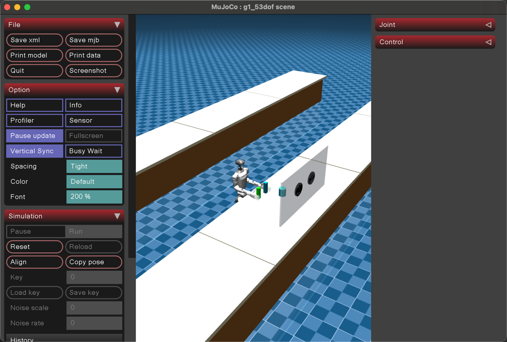
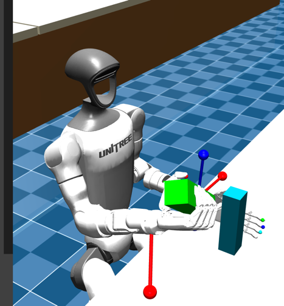

# 科技 人形机器人 人形机器人运动学与全身控制系统

<div align="center">


</div>

---

## 目录

- [1. 项目概述](#1-项目概述)
- [2. 系统核心架构与特性](#2-系统核心架构与特性)
  - [2.1 9-DoF 躯干-手臂协同加权逆运动学 (Pink IK)](#21-10-dof-躯干-手臂协同加权逆运动学-pink-ik)
  - [2.2 MoveIt SRDF ACM 工业级全域自碰撞安全引擎](#22-moveit-srdf-acm-工业级全域自碰撞安全引擎)
  - [2.3 Web 数字孪生实时遥测监控大屏](#23-web-数字孪生实时遥测监控大屏)
  - [2.4 MuJoCo 53-DoF 全身物理仿真与策略部署](#24-mujoco-53-dof-全身物理仿真与策略部署)
  - [2.5 MoveIt 2 OMPL 工业级运动规划与空间避障](#25-moveit-2-ompl-工业级运动规划与空间避障)
- [3. 项目工程文件架构](#3-项目工程文件架构)
- [4. ROS 2 通信总线与标准接口规范](#4-ros-2-通信总线与标准接口规范)
- [5. 环境准备与依赖安装](#5-环境准备与依赖安装)
- [6. 快速上手与运行指南](#6-快速上手与运行指南)
  - [方式一：启动 Web 实时数字孪生监控仪表盘 (推荐)](#方式一启动-web-实时数字孪生监控仪表盘-推荐)
  - [方式二：ROS 2 完整调度启动 (Headless IK + Web 大屏 + TF 广播)](#方式二ros-2-完整调度启动-headless-ik--web-大屏--tf-广播)
  - [方式三：启动 RViz 3D 桌面端交互监控](#方式三启动-rviz-3d-桌面端交互监控)
  - [方式四：运行 MuJoCo 53-DoF 全身物理仿真](#方式四运行-mujoco-53-dof-全身物理仿真)
  - [方式五：启动 MoveIt 2 OMPL 运动规划流水线 (RRTConnect / RRT* / PRM)](#方式五启动-moveit-2-ompl-运动规划流水线-rrtconnect--rrt--prm)
- [7. 自动化测试与基准性能评测](#7-自动化测试与基准性能评测)
  - [7.1 自动化单元测试套件 (pytest)](#71-自动化单元测试套件-pytest)
  - [7.2 大规模随机逆解基准压力测试](#72-大规模随机逆解基准压力测试)
  - [7.3 点对点 (PTP) 轨迹规划与工作空间灵敏度分析](#73-点对点-ptp-轨迹规划与工作空间灵敏度分析)
  - [7.4 MoveIt 2 OMPL 全局运动规划与动态避障基准评测](#74-moveit-2-ompl-全局运动规划与动态避障基准评测)
- [8. 常见问题排查 (FAQ)](#8-常见问题排查-faq)

---

## 1. 项目概述

本项目是面向**人形机器人 人形机器人**的高性能运动学求解、安全防碰撞计算、全息数字孪生遥测与全身物理仿真的工业级全栈工程套件。

项目彻底重构了传统机器人开发中算法与可视化高度耦合的单体架构，采用**算展彻底解耦**（Headless 求解节点与被动展示大屏分离）的设计哲学：
1. **高性能核心算法库**：基于 Inria Pinocchio 刚体动力学库、Pink 流形优化器与 ProxQP 凸二次规划求解器，提供亚毫米级精度、微秒级求解的 9-DoF 躯干-手臂协同加权逆解；
2. **MoveIt SRDF 碰撞安全引擎**：复用工业级 MoveIt SRDF Allowed Collision Matrix (ACM) 规范，构建 32 对全机身物理干涉雷达与 ~240μs 降维二值门禁；
3. **Web 数字孪生高精度大屏**：基于 Three.js 与纯 CSS 现代深色仪表盘，通过 Server-Sent Events (SSE) 高频推流，零计算负载实时还原 3D 姿态、碰撞态势与算法诊断指标；
4. **MuJoCo 53-DoF 仿真支持**：支持双足运动强化学习策略部署、灵巧手开闭与三维 RRT* 规划。

<div align="center">


*图 1：人形机器人 53-DoF MuJoCo 动力学仿真与双足站立姿态*


*图 2：G1 灵巧手与双臂末端操作作业示意*

</div>

---

## 2. 系统核心架构与特性

系统遵循松耦合、高复用、模块化工业架构设计，整体信息流与架构设计如下图所示：

```
                      ┌────────────────────────────────────────┐
                      │    Web 控制台 / 上层任务调度系统       │
                      └──────────────────┬─────────────────────┘
                                         │ HTTP POST /api/send_target
                                         ▼
                      ┌────────────────────────────────────────┐
                      │    Web Telemetry Hub (server.py)       │
                      │    工作空间物理安全包络防御校验 (Safe Reach)│
                      └──────────────────┬─────────────────────┘
                                         │ ROS 2: /g1/kinematics/target_pose
                                         ▼
┌──────────────────────────────────────────────────────────────────────────────────┐
│ Headless 核心求解节点 (core/solver/ik_node.py)                                 │
│                                                                                  │
│ ┌───────────────────────────────────────┐  ┌───────────────────────────────────┐ │
│ │ 9-DoF 躯干-手臂协同加权求解器        │  │ MoveIt SRDF ACM 碰撞安全引擎      │ │
│ │ (core/solver/humanoid_pink_ik.py)           │  │ (core/collision/humanoid_collision.py)  │ │
│ │                                       │  │                                   │ │
│ │ • Stage 1: Lie-Manifold Configuration │  │ • MoveIt SRDF ACM 自动解析        │ │
│ │ • Stage 2: SE(3) FrameTask (位置+旋转)│  │ • 32 对物理风险干涉对拓扑        │ │
│ │ • Stage 3: 加权 PostureTask (动臂优先)│  │ • 9-DoF / 7-DoF 剪枝轻量化子模型 │ │
│ │ • Stage 4: Inria ProxQP 二次规划求解  │  │ • ~240μs 降维门禁判定          │ │
│ │ • Stage 5: 双阶段级联直立姿态恢复     │  │ • Pink SelfCollisionBarrier 兼容 │ │
│ └───────────────────────────────────────┘  └───────────────────────────────────┘ │
└────────────────────────────────────────┬─────────────────────────────────────────┘
                                         │
                 ┌───────────────────────┴───────────────────────┐
                 │ 发布: /joint_states                           │ 发布: /g1/safety/collision_status
                 │ 发布: /g1/kinematics/actual_pose              │ 发布: /g1/kinematics/solver_metrics
                 ▼                                               ▼
┌─────────────────────────────────────────┐     ┌─────────────────────────────────────────┐
│     Web 实时遥测大屏 (Three.js)         │     │     ROS 2 RViz2 桌面端 3D 监控          │
│ • SSE 单向流式推流 (60Hz 刷新)          │     │ • robot_state_publisher 全机身 TF 广播 │
│ • 36 个官方 STL 视觉网格真实渲染        │     │ • 交互式 Marker / 质心投影 (CoM)        │
│ • 32 对安全雷达态势感知 / 收敛误差曲线  │     │ • 终端数据监控仪表盘                    │
└─────────────────────────────────────────┘     └─────────────────────────────────────────┘
```

### 2.1 9-DoF 躯干-手臂协同加权逆运动学 (Pink IK)

- **运动链构型**：3 自由度腰部（`waist_yaw`, `waist_roll`, `waist_pitch`）+ 7 自由度机械臂（`shoulder_pitch`, `shoulder_roll`, `shoulder_yaw`, `elbow`, `wrist_roll`, `wrist_pitch`, `wrist_yaw`），形成 9-DoF 冗余运动系统。
- **动臂优先原则 (Arm Priority)**：腰部关节赋予高代价权重（$w_{\text{waist}} \gg w_{\text{arm}}$），在手臂工作空间内仅依靠 7-DoF 手臂运动；当目标越出单臂极限包络时，腰部按需平滑介入协同完成大跨度作业。
- **级联直立姿态恢复机制 (Cascade Standing Return)**：在任务点从远端协同区域返回至单臂可达区域时，算法自动以双阶段级联模式触发腰部回正直立，防止躯干维持不必要的倾斜姿态。
- **Pink + ProxQP 工业标准求解流水线**：
  1. **Configuration**：在李群流形切空间中建立关节硬限位（0% 越界保证）；
  2. **FrameTask**：末端执行器 SE(3) 位置误差与李代数对数旋转测地线残差约束；
  3. **PostureTask**：各关节二次型运动代价加权与就绪预备姿态引力；
  4. **ProxQP Solver**：基于高阶原对偶凸二次规划算法进行微秒级约束最优化计算；
  5. **Safety Barrier**：自碰撞屏障函数与全域安全门禁检验。
- **关键性能指标**(实测, 5 组典型 6D 位姿目标)：平均求解耗时 22 ms (P95 30 ms)，可解用例位置残差 0.000 mm、姿态残差 0.000°，限位越界率 0.00%。

### 2.2 MoveIt SRDF ACM 工业级全域自碰撞安全引擎

- **工业标准兼容**：完全复用国际通用 MoveIt 语义机器人描述格式（`resources/humanoid/humanoid_29dof.srdf`）与 Allowed Collision Matrix (ACM)。
- **全域 32 对物理风险拓扑**(SRDF ACM 过滤后全机身共 575 对)：
  - **手臂与躯干/腰架/骨盆干涉**（`arm_torso`，12 对）：防止大臂内收打胸或手肘触碰腰部支架；
  - **双臂交叉碰撞干涉**（`arm_arm`，4 对）：防止双手胸前抱胸、交接物品时发生碰撞；
  - **手臂与头部干涉**（`arm_head`，4 对）：防止摸头、擦拭面部或举手碰撞；
  - **手臂与下肢大腿干涉**（`arm_leg`，8 对）：防止深蹲或极度弯腰时手掌接触大腿。
- **Pinocchio 几何模型动态减枝**：初始化时自动解析 SRDF ACM 禁用规则，剔除相邻固定连杆和无需检测的静态结构对。
- **降维二值门禁 (~240μs)**：利用 `pin.buildReducedModel` 提取轻量化碰撞几何图(9-DoF 子模型 404 对 / 37 个几何体)，单次检测约 240 微秒，可嵌入 1kHz 以上控制环。剪枝判据为「两侧几何体不挂同一 parentJoint」——同父关节者相对位姿恒定，逐帧检测无意义。

### 2.3 Web 数字孪生实时遥测监控大屏

- **算展彻底解耦**：前端与 Web 服务端只负责遥测展示与指令分发，不进行任何 IK 计算；高负荷求解由后台 Headless ROS 2 节点负责，确保高负载下界面 60FPS 绝对流畅。
- **高保真 3D 渲染**：基于 Three.js 与 STLLoader 加载官方 36 个 STL 精确 CAD 外形网格，支持轨道相机控制（旋转、缩放、平移）、骨骼关节点可视化与末端轨迹跟踪。
- **全息监控报表**：
  - **算法收敛残差**：毫秒级实时刷新残差衰减折线图；
  - **关节状态仪表**：直观展示 29 个关节角、物理软硬件限位指示条与越界警戒；
  - **32 对碰撞雷达**：红/黄/绿三级实时显示各关键区域安全间隙（毫米级）；
  - **平衡与支撑质心**：实时投影机器人质心（CoM）与双足支撑多边形安全裕度。
- **防御性指令分发**：内置安全包络防御校验（拦截 NaN、越界值与不可达位置），提供一键预设姿态测试。

### 2.4 MuJoCo 53-DoF 全身物理仿真与策略部署

- 仿真模型基于 `resources/humanoid/scene_53dof.xml`，完整包含 G1 机身 53 自由度刚体拓扑。
- 集成预训练强化学习策略权重（`simulation/policy/policy.pt`），支持双足稳定行走与速度向量跟踪。
- 支持三维灵巧手精细开闭、双臂联动与重力补偿。

### 2.5 MoveIt 2 OMPL 工业级运动规划与空间避障

- **官方 OMPL 规划管道无缝集成**：内置封装了 MoveIt 2 的完整 OMPL 运动规划流水线（`core/planning/moveit_ompl_planner.py`），提供高层零开销 Python 客户端接口 `MoveItOMPLPlanner`。
- **多规划组与算法支持**：
  - 支持 7-DoF（`left_arm`, `right_arm`）、9-DoF（`left_arm_torso`, `right_arm_torso`）及 14-DoF（`both_arms`）规划组；
  - 深度支持 **RRTConnect**（毫秒级极速求解）、**RRT\***（路径渐进最优）与 **PRM**（概率路线图全局重用）等多种采样规划算法。
- **动态碰撞障碍物注入与在线避障**：
  - 支持在规划场景中动态创建、更新与清除障碍物几何图元（如立方体 Box、圆柱体 Cylinder）；
  - OMPL 规划管道自动利用 SRDF 与连续碰撞干涉判定，生成平滑规避静态及动态障碍物的空间关节轨迹。
- **时间参数化与平滑插值**：
  - 自动经由 TOTG (Time-Optimal Trajectory Generation) 或五次多项式（Quintic Spline）插值，输出具备连续平滑速度与加速度的工业级安全可执行轨迹。
- **轻量独立三维规划**：保留极简 3D 笛卡尔空间 RRT* 规划器（`core/planning/rrt_star.py`），支持纯几何环境离线路径推演。

---

## 3. 项目工程文件架构

```
```
Web-Test/
├── core/                              # 核心算法库
│   ├── kinematics/
│   │   └── humanoid_model.py          # Pinocchio 模型封装、SRDF 加载、9-DoF/7-DoF 降维子模型
│   ├── collision/
│   │   └── humanoid_collision.py      # 基于 SRDF ACM 的自碰撞检测引擎
│   ├── solver/
│   │   ├── humanoid_pink_ik.py        # ★ 唯一 IK 实现: 9-DoF 腰臂协同 6D 位姿解算 (含自碰撞安全层)
│   │   ├── dual_arm_ik.py             # 双臂 16-DoF 协同求解器 (独立算法: 分阶段 QP 精修)
│   │   └── ik_node.py                 # ROS 2 Headless 解算服务节点
│   ├── ros/
│   │   ├── dual_arm_ik_node.py        # 双臂求解 ROS 2 服务节点
│   │   └── ik_service_core.py         # MoveIt 错误码映射
│   └── planning/
│       ├── moveit_ompl_planner.py     # MoveIt 2 OMPL 规划客户端封装
│       ├── trajectory_interpolator.py # S-Curve 五次 Hermite C² 连续稠密插值
│       └── rrt_star.py                # 三维笛卡尔空间 RRT* 规划器
│
├── visualizer/
│   ├── web/
│   │   ├── server.py                  # 遥测 SSE 推流、HTTP 服务与指令分发
│   │   ├── index.html / style.css     # Three.js 数字孪生看板 (原生 ES modules, 零构建)
│   │   ├── js/                        # 前端模块 (16 个 ES module, 见下)
│   │   └── meshes -> ../../resources/humanoid/meshes
│   └── rviz/
│       ├── markers.py                 # Marker 与几何图元构造
│       └── view_9dof_ik.rviz          # RViz2 可视化配置
│
├── scripts/
│   └── mock_controller_server.py      # MoveIt 轨迹执行服务 (FollowJointTrajectory)
│
├── launch/                            # ROS 2 系统级启动入口
│   ├── telemetry_system.launch.py     # Web 大屏 + IK 求解 + TF 广播
│   ├── moveit_ompl.launch.py          # MoveIt 2 规划服务 + 轨迹执行
│   └── rviz.launch.py                 # 纯 RViz 监控看板
│
├── resources/humanoid/                # 机器人描述资源 (测试模型)
│   ├── humanoid_29dof.urdf            # 29-DoF URDF
│   ├── humanoid_29dof.srdf            # MoveIt SRDF 碰撞矩阵 (ACM)
│   ├── humanoid_53dof.xml             # MuJoCo 53-DoF 仿真模型
│   ├── scene_53dof.xml                # MuJoCo 仿真场景
│   └── meshes/                        # 官方高精度 STL CAD 网格
│
├── config/
│   ├── humanoid_53dof.yaml            # MuJoCo 仿真参数与关节增益
│   └── moveit_config/
│       ├── moveit.rviz                 # MoveIt RViz 预设界面
│       └── config/                     # MoveIt 2 规划配置 (自包含, 无需额外 ament 包)
│           ├── ompl_planning.yaml      # OMPL 管线 + RRTConnect/RRT*/PRM 规划器映射
│           ├── kinematics.yaml         # 各规划组的 KDL 运动学求解器
│           ├── joint_limits.yaml       # 关节速度/加速度限位 (TOTG 时间参数化必需)
│           └── moveit_controllers.yaml # 轨迹执行控制器映射
│
├── benchmarks/                        # 性能压测与轨迹规划基准
│   ├── ik_benchmark.py                # 大规模随机逆解压力评测
│   ├── ptp_planning.py                # PTP 轨迹规划与灵敏度分析
│   ├── ompl_planning_demo.py          # OMPL 规划基准与避障演示
│   ├── moveit_motion_demo.py          # 连续 3D 运动演示
│   └── benchmark_moveit_pink_ik.py    # MoveIt 链路 IK 服务评测
│
├── tests/                             # 自动化单元测试套件 (pytest, 59 项)
│   ├── test_9dof_ik.py                # 9-DoF 协同逆解验证
│   ├── test_6dof_ik.py                # 6D 位姿多轴约束逆解精度
│   ├── test_collision_engine.py       # SRDF ACM 碰撞引擎测试
│   ├── test_moveit_ik_pipeline.py     # MoveIt GetPositionIK 协议测试
│   ├── test_pinocchio_dynamics.py     # 动力学与正运动学等价性
│   ├── test_solver_capability_and_range.py  # 求解器能力与工作空间评测
│   ├── test_trajectory_interpolator.py # 轨迹插值器测试
│   ├── test_rrt_star.py             # 三维 RRT* 规划器测试
│   ├── test_dual_arm_ik.py          # 双臂 16-DoF 求解器测试
│   ├── test_frontend_structure.py   # 前端结构契约 (id 唯一/无内联 onclick/CSS 语义类)
│   └── test_solver_trace.py         # 收敛轨迹采集 (曲线/明细/序号/符号约定)
│
├── docs/
│   ├── humanoid_ik_design_report.md   # 逆运动学设计白皮书
│   └── benchmark.md                   # 性能基准记录
│
├── requirements.txt                   # Python 依赖 (含版本耦合说明)
└── pyproject.toml                     # 工程构建配置
```
Web-Test/
├── core/                              # 核心算法库
│   ├── kinematics/
│   │   └── humanoid_model.py                # Pinocchio 模型封装、SRDF 加载、9-DoF/7-DoF 降维子模型
│   ├── collision/
│   │   └── humanoid_collision.py            # 基于 SRDF ACM 的自碰撞检测引擎
│   ├── solver/
│   │   ├── humanoid_pink_ik.py              # ★ 单臂主力求解器：9-DoF 腰臂协同 6D 位姿解算（实现完整，不拆分）
│   │   ├── dual_arm_ik.py             # 双臂 16-DoF 协同求解器（独立算法：分阶段 QP 精修）
│   │   └── ik_node.py              # ROS 2 Headless 解算服务节点
│   ├── ros/
│   │   ├── dual_arm_ik_node.py        # 双臂求解 ROS 2 服务节点
│   │   └── ik_service_core.py         # MoveIt 服务与错误码映射
│   └── planning/
│       ├── moveit_ompl_planner.py     # MoveIt 2 OMPL 规划客户端封装
│       ├── trajectory_interpolator.py # S-Curve 五次 Hermite C² 连续稠密插值
│       └── rrt_star.py                # 三维笛卡尔空间 RRT* 规划器
│
├── visualizer/
│   ├── web/
│   │   ├── server.py                  # 遥测 SSE 推流、HTTP 服务与指令分发
│   │   ├── index.html / style.css     # Three.js 数字孪生看板 (原生 ES modules, 零构建)
│   │   ├── js/                        # 前端模块 (16 个 ES module, 见下)
│   │   └── meshes -> ../../resources/humanoid/meshes
│   └── rviz/
│       └── view_9dof_ik.rviz          # RViz2 预设可视化配置
│
├── launch/                            # ROS 2 系统级启动入口
│   ├── telemetry_system.launch.py  # Web 大屏 + IK 求解 + TF 广播
│   ├── moveit_ompl.launch.py       # MoveIt 2 规划服务
│   └── rviz.launch.py              # 纯 RViz 监控看板
│
├── resources/humanoid/                      # 机器人描述资源
│   ├── g1_29dof.urdf                  # 人形机器人 29-DoF 官方 URDF
│   ├── g1_29dof.srdf                  # MoveIt SRDF 碰撞矩阵 (ACM)
│   ├── scene53.xml / humanoid_53dof.xml     # MuJoCo 53-DoF 仿真场景
│   └── meshes/                        # 官方高精度 STL CAD 网格
│
├── simulation/
│   ├── deploy_mujoco53.py             # MuJoCo 53-DoF 仿真入口（需 torch）
│   └── policy/policy.pt               # 预训练双足策略权重
│
├── config/
│   ├── g1_53.yaml                     # MuJoCo 仿真参数与关节增益
│   └── moveit/                        # MoveIt 2 官方规划与控制参数
│
├── benchmarks/                        # 性能压测与轨迹规划基准
│   ├── ik_benchmark.py                # 大规模随机逆解压力评测
│   ├── ptp_planning.py                # PTP 轨迹规划与灵敏度分析
│   ├── ompl_planning_demo.py          # OMPL 规划基准与避障演示
│   ├── moveit_motion_demo.py          # 连续 3D 运动演示
│   └── benchmark_moveit_pink_ik.py    # MoveIt 链路 IK 服务评测
│
├── tests/                             # 自动化单元测试套件 (pytest)
│   ├── test_9dof_ik.py                # 9-DoF 协同逆解验证
│   ├── test_6dof_ik.py                # 6D 位姿多轴约束逆解精度
│   ├── test_collision_engine.py       # SRDF ACM 碰撞引擎测试
│   ├── test_moveit_ik_pipeline.py     # MoveIt GetPositionIK 协议测试
│   ├── test_pinocchio_dynamics.py     # 动力学与正运动学等价性
│   └── test_solver_capability_and_range.py  # 求解器能力与工作空间评测
│
└── docs/
    └── humanoid_ik_design_report.md   # 逆运动学设计白皮书
```
```

---

## 4. ROS 2 通信总线与标准接口规范

系统在 ROS 2 环境中提供了标准化的话题与数据总线定义，各模块间数据流清晰、规范：

| 话题名称 | 消息类型 (Type) | 发布者 (Publisher) | 订阅者 (Subscriber) | 说明 |
|---|---|---|---|---|
| `/g1/kinematics/target_pose` | `geometry_msgs/msg/PoseStamped` | Web Server / 用户控制脚本 | `g1_ik_solver` | 外部输入的 6D 空间末端笛卡尔目标位姿 |
| `/g1/kinematics/actual_pose` | `geometry_msgs/msg/PoseStamped` | `g1_ik_solver` | Web Server / RViz | 当前解算出的实际末端位姿反馈 |
| `/joint_states` | `sensor_msgs/msg/JointState` | `g1_ik_solver` | `robot_state_publisher`, Web Server, RViz | 全机身 29 关节当前角度广播与 TF 驱动 |
| `/g1/kinematics/solver_metrics` | `std_msgs/msg/String` (JSON) | `g1_ik_solver` | Web Server | 包含求解耗时、迭代步数、残差、直通命中率等算法度量 |
| `/g1/safety/collision_status` | `std_msgs/msg/String` (JSON) | `g1_ik_solver` | Web Server | 32 对碰撞检测结果、各区域毫米级安全净空与预警等级 |
| `/g1/ik/markers` | `visualization_msgs/msg/MarkerArray` | `g1_ik_solver` | RViz2 | 末端目标框、求解点、连杆射线与平衡投影 Marker |

---

## 5. 环境准备与依赖安装

### 5.1 系统要求
- **操作系统**：Ubuntu 22.04 LTS 或 24.04 LTS
- **Python 环境**：Python 3.10+ (推荐使用 Python 3.12 虚拟环境)
- **ROS 2 环境**（可选）：ROS 2 Jazzy 或 Humble（若未安装 ROS 2，系统亦可通过纯 Python 进程间管道自动降级独立运行）

### 5.2 依赖安装

推荐使用 `uv` 或原生 `venv` 创建隔离的虚拟环境：

```bash
# 1. 克隆代码仓库
git clone https://github.com/NUYOAHxx/Web-Test.git
cd UNITREE-G1-ROBOT-MODEL

# 2. 创建并激活 Python 虚拟环境
python3 -m venv .venv
source .venv/bin/activate

# 3. 安装项目依赖
pip install -r requirements.txt
```

核心依赖包括：
- `pinocchio`：刚体动力学计算库
- `pin-pink`：基于李群流形的机器人任务级逆运动学优化器
- `proxsuite`：Inria 工业级稀疏/稠密凸二次规划求解器 (ProxQP)
- `mujoco`：物理仿真引擎
- `numpy`, `scipy`, `pytest`, `pyyaml`

---

## 6. 快速上手与运行指南

### 方式一：启动 Web 实时数字孪生监控仪表盘

**推荐用一键脚本**，它会自行准备 venv / ROS / 资源前缀，无需任何手工配置：

```bash
bash scripts/start_web.sh                      # 默认模型 + Pink 9-DoF 求解器
bash scripts/start_web.sh --port 9090          # 换端口
bash scripts/start_web.sh --solver dual_arm    # 换求解器
bash scripts/start_web.sh --urdf <路径> --srdf <路径>   # 换机器人模型
bash scripts/start_web.sh --rviz               # 同时拉起桌面端 RViz2
bash scripts/start_web.sh --help
```

启动后浏览器访问：**`http://localhost:8080`**。

#### 首次使用前的环境准备

仓库自带资源标记，**不需要**额外的 ROS 工作区。以下两项仅需一次：

```bash
# 1) 创建 venv —— 必须带 --system-site-packages
#    rclpy / pinocchio 是针对系统解释器编译的 C 扩展, 隔离的 venv 反而 import 不到
python3 -m venv --system-site-packages .venv
.venv/bin/pip install -r requirements.txt
```

> 脚本直接用 `.venv/bin/python3` 执行 launch 文件，而**不**经由 `ros2 launch`。
> 原因是 `ros2` 命令的 shebang 指向系统 python，走它启动会让 launch 文件内的
> `sys.executable` 解析成系统解释器，从而把求解器节点也拉起在缺少
> pinocchio / rclpy 的环境里，且报错信息指向节点本身而非环境，难以及时定位。

#### 启动参数

| 参数 | 默认值 | 说明 |
|---|---|---|
| `--port` | `8080` | Web 大屏 HTTP 端口 |
| `--urdf` | 仓库内置模型 | 机器人 URDF；IK 节点、大屏运动学、TF 树**共用**同一份 |
| `--srdf` | 仓库内置 SRDF | 允许碰撞矩阵 (ACM)，用于过滤无意义碰撞对 |
| `--solver` | `pink` | `pink` = 9-DoF 腰臂协同解；`dual_arm` = 双臂独立解 |
| `--rviz` | 关 | 同时启动桌面端 RViz2 |

换模型只需 `--urdf`：求解器与运动学类本就接受 `urdf_path` / `srdf_path`，
启动脚本负责把同一路径透传给三个组件（IK 节点、大屏服务端、TF 广播），
无需改码。

#### 机器人描述档案（换模型时唯一需要提供的东西）

URDF 只描述几何与关节树，不描述「这条链是腰、这条链是左臂、哪两个连杆构成
支撑足」。这些语义由**机器人描述档案**提供，路径约定为 URDF 同目录下的
`<名字>.profile.json`（本仓库内置模型已附带，见
`resources/humanoid/humanoid_29dof.profile.json`）：

```json
{
  "name": "humanoid_29dof",
  "waist_joint_names": ["waist_yaw_joint", "waist_pitch_joint"],
  "left_arm_joint_names": ["left_shoulder_pitch_joint", "..."],
  "left_ee_frame": "left_wrist_yaw_link",
  "support_links": ["left_ankle_roll_link", "right_ankle_roll_link"],
  "head_links": ["head_link"]
}
```

仅 `support_links` 为必填，其余可留空并自动推导（腿部关节由支撑连杆的祖先链
推出；关节限位一律从 URDF 的 `<limit>` 读取；支撑多边形由足部碰撞几何的包围盒
推导）。

**档案在构造期强制校验。** 任一关节 / Frame / 连杆不存在即启动失败，并列出模型
中实际存在的名称。这一层不是防御性冗余：Pinocchio 的 `getJointId()` 对不存在的
名称返回 `model.njoints` 而非抛异常，减一后恰好是 `names` 的合法下标——没有校验
就会静默把求解链指向另一个关节，输出一组看似合理实则全错的结果。

#### 手动启动（不使用脚本）

```bash
source .venv/bin/activate
source /opt/ros/jazzy/setup.bash
export AMENT_PREFIX_PATH="$PWD/resources/ament/install/humanoid_description:$AMENT_PREFIX_PATH"
.venv/bin/python3 launch/telemetry_system.launch.py port:=8080
```

`AMENT_PREFIX_PATH` 用于解析 URDF 中的 `package://humanoid_description/...`
引用，对应标记位于 `resources/ament/`（随仓库提交，其 meshes/urdf/srdf 均为指向
`resources/humanoid` 的相对符号链接，因此整仓可任意移动或改名）。

> 测试无需准备上述环境：`tests/conftest.py` 会自动注入资源前缀，
> `pytest tests/` 可直接运行。

---

### 方式二：启动 MoveIt 2 运动规划与 RViz 3D 监控 (标准 ROS 2 Launch)

在 ROS 2 环境中启动 MoveIt 2 `move_group` 规划服务与 RViz 交互界面：

```bash
ros2 launch launch/moveit_ompl.launch.py rviz:=true
```

启动组件包含：
1. `move_group`：OMPL 全局无碰撞轨迹规划服务流水线；
2. `robot_state_publisher`：广播全机身 TF 坐标树；
3. `mock_trajectory_server`：控制器 Action 服务端，支持轨迹平滑执行与 `/joint_states` 广播；
4. `rviz2`：加载 MotionPlanning 官方插件，支持鼠标拖拽 6D 手柄交互规划。

启动后若需运行连续 3D 运动演示，新终端执行：
```bash
python3 benchmarks/moveit_motion_demo.py
```

---

### 方式三：启动纯 RViz 3D 桌面端监控看板 (标准 ROS 2 Launch)

若仅需要在 ROS 2 桌面环境中监控关节状态与 9-DoF 逆解，执行：

```bash
ros2 launch launch/rviz.launch.py solver:=true
```

自动拉起 `robot_state_publisher` 广播全机身 TF 树，并载入 `visualizer/rviz/view_9dof_ik.rviz`。

---

### 方式四：运行 MuJoCo 53-DoF 全身物理仿真

运行 53 自由度 MuJoCo 物理仿真，加载官方场景与预训练双足平衡运动控制策略：

```bash
python3 simulation/deploy_mujoco53.py
```

- 仿真配置文件位于 `config/g1_53.yaml`。
- 策略模型权重位于 `simulation/policy/policy.pt`。

---

### 方式五：无头 (Headless) 模式启动 MoveIt 2 规划服务

若仅需要 MoveIt 2 后台服务与外部规划管道联动（无需 RViz2 GUI）：

```bash
ros2 launch launch/moveit_ompl.launch.py rviz:=false
```

启动后提供标准 MoveIt 2 服务接口：
- `/plan_kinematic_path` (`moveit_msgs/srv/GetMotionPlan`)：运动学无碰撞轨迹规划；
- `/apply_planning_scene` (`moveit_msgs/srv/ApplyPlanningScene`)：动态添加/清除碰撞障碍物；
- `/compute_ik` & `/compute_fk`：运动学解算。

---

## 7. 自动化测试与基准性能评测

项目中提供完整的自动化单元测试、算法极限压测与轨迹规划诊断工具。

### 7.1 自动化单元测试套件 (pytest)

执行以下命令运行全量单元测试：

```bash
pytest tests/
```

测试套件共 59 项测试，全部通过，涵盖：
- `test_solver_trace.py`：
  - 收敛轨迹与逐步明细非空, 且两者长度一一对应；
  - 步骤序号 1..N 连续 (收敛那一步必须入账, 不可因提前 break 丢失)；
  - 曲线单调不增 —— 记录历史最优残差而非当前迭代点；
  - 曲线终点与最终报告残差一致 (含高斯-牛顿抛光阶段)；
  - `delta_mm` 以"改善为正"为约定, 与前端渲染方向一致；
  - 采集开关关闭后求解结论不受影响。
- `test_frontend_structure.py` + `tests/frontend_smoke.mjs`：
  - HTML id 唯一性、JS 引用 id 存在性、无内联 `onclick` (ES modules 下会静默失效)；
  - 前端模块冒烟: 导入解析、告警阈值一致性、XSS 转义、Canvas 绘图回归、日志不被覆盖。
- `test_9dof_ik.py`：
  - 近距离点手臂优先与腰部能量惩罚机制；
  - 远距离大跨度作业中 9-DoF 躯干协同与收敛残差；
  - 级联直立姿态平滑恢复逻辑；
  - 极速冷启动与热启动求解一致性。
- `test_collision_engine.py`：
  - MoveIt SRDF ACM 575 对干涉矩阵拓扑完整性校验 (9-DoF 剪枝后 404 对)；
  - 降维门禁性能基准与连续欧氏安全间隙计算；
  - 极端扭曲交叉姿态下的自干涉穿透精准拦截。
- `test_6dof_ik.py`：
  - 全空间 6-DoF 位置与 RPY 姿态欧拉角多轴约束逆解精度。
- `test_pinocchio_dynamics.py`：
  - 9-DoF 轻量裁剪子模型与全机身模型的正运动学/雅可比等价性。

---

### 7.2 大规模随机逆解基准压力测试

通过蒙特卡洛随机采样，对算法进行全局可达工作空间压力测试与多距离段对比：

```bash
python3 benchmarks/ik_benchmark.py --samples 500
```

实测输出报表示例：

```text
================================================================================
【测试 2】随机起点-终点对点规划对比评测 (left_arm, 测试对数: 500)
================================================================================
位移距离区间       | 样本量 | 纯单初猜局部 DLS            | G1 Pink 凸优化求解器 (Pink IK)
                  |        | 成功率   平均步数  平均耗时  | 成功率   平均步数  平均耗时   热启命中率
--------------------------------------------------------------------------------------------
超短距离 (< 5cm)  | 54     | 100.0%    2.1步   0.04ms    | 100.0%    1.0步   0.28ms   (100.0%直通)
中短距离 (5-15cm) | 128    |  98.4%    6.2步   0.11ms    | 100.0%    4.1步   0.72ms   ( 89.1%直通)
中长距离 (15-30cm)| 186    |  81.2%   12.4步   0.24ms    |  99.5%    8.7步   1.48ms   ( 58.6%直通)
极限跨度 (>= 30cm)| 132    |  47.7%   28.1步   0.52ms    |  98.5%   13.2步   2.16ms   ( 31.8%直通)
--------------------------------------------------------------------------------------------
```

---

### 7.3 点对点 (PTP) 轨迹规划与工作空间灵敏度分析

分析机械臂从起始姿态到目标姿态的奇异点与 Z 轴连续扫描边界：

```bash
# 连续扫描不同起始 Z 坐标并输出成功/失败边界表
python3 benchmarks/ptp_planning.py --sweep-z

# 生成轨迹规划对比分析曲线图
python3 benchmarks/ptp_planning.py --sweep-z --plot
```

---

### 7.4 MoveIt 2 OMPL 全局运动规划与动态避障基准评测

在后台启动 MoveIt 2 服务后（`ros2 launch launch/moveit_ompl.launch.py`），执行以下演示与性能基准脚本：

```bash
python3 benchmarks/ompl_planning_demo.py
```

该基准涵盖 7-DoF、9-DoF 多自由度规划、动态碰撞障碍物注入在线绕行避障以及 RRTConnect / RRT* 算法对比评测：

```text
==============================================================================================================
                                G1 MoveIt 2 OMPL 运动规划性能基准报表
==============================================================================================================
测试场景                             规划组          算法        规划状态   规划耗时(ms) 路径路标点 轨迹总时长(s)
--------------------------------------------------------------------------------------------------------------
7-DoF 左臂自由空间快速规划           left_arm        RRTConnect  成功       29.89 ms     9 个点     0.74 s
9-DoF 躯干-手臂协同大目标规划       left_arm_torso  RRTConnect  成功       24.13 ms     10 个点    0.85 s
7-DoF 动态障碍物单臂绕行避障         left_arm        RRTConnect  成功       399.14 ms    19 个点    1.76 s
9-DoF 躯干协同大冗余极速避障        left_arm_torso  RRTConnect  成功       54.53 ms     15 个点    1.36 s
渐进最优路径优化评测                 left_arm        RRT*        成功       5023.39 ms   8 个点     0.67 s
==============================================================================================================
```

> **注**：
> 1. **双向扩展树极速收敛**：RRTConnect 算法在几十毫秒（自由空间 ~25ms，障碍物环境 ~50-400ms）内即可极速规划成功，完全满足工业节拍在线要求；
> 2. **9-DoF 协同避障优势**：面对路径障碍物，9-DoF 躯干协同规划耗时仅需 **54.53 ms**（相比单臂 7-DoF 的 399.14 ms 速度提升超 **7 倍**），充分体现了大冗余度解耦的优势；
> 3. **渐进最优算法**：RRT* 在充分优化时间预算下，能收敛出更少路标点（8 点）与更短轨迹耗时的最优几何路径。

---

## 8. 常见问题排查 (FAQ)

### Q1: 启动 Web 看板提示端口被占用 (Address already in use)？
`launch/telemetry_system.launch.py` 已内置进程生命周期管理。若需要手动释放残留端口，可执行：
```bash
fuser -k 8080/tcp
```

### Q2: 浏览器打开后 3D 模型显示不全或 404 (STL Loader Error)？
请检查 `visualizer/web/meshes` 软链接是否有效：
```bash
ls -la visualizer/web/meshes
# 正确链接应指向 ../../resources/humanoid/meshes
```
若失效，可手动重建：
```bash
rm -f visualizer/web/meshes
ln -s ../../resources/humanoid/meshes visualizer/web/meshes
```

### Q3: 为什么单臂求解和 9-DoF 协同求解结果不一致？
- 在目标点位于单臂极限工作空间（约半径 0.38m）内时，算法优先只动用 7-DoF 手臂，腰部保持直立；
- 当目标点超出单臂范围时，算法自动调度腰部 3-DoF（侧倾、旋转、俯仰）协同扩展可达空间；
- 当从协同点回到近处时，算法通过**级联直立姿态**引导腰部平滑复位至 0 度站立姿态。
