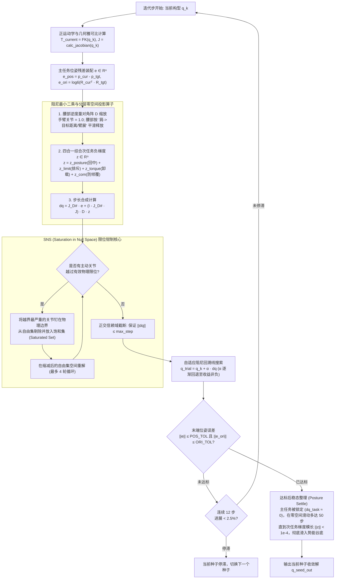
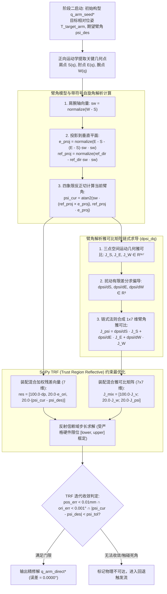
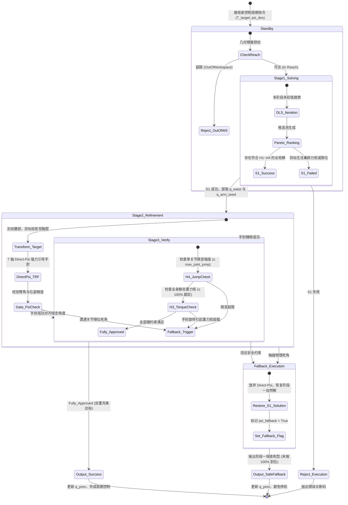

# 9 轴腰臂协同 + 指定臂角（Direct-Psi）级联求解系统完整架构规范文档

---

## 1. 系统全景架构设计

本系统针对人形机器人“腰 2 + 臂 7”共 9 自由度的冗余运动学系统，解决了**在全作业空间内精准达成 6D 末端位姿硬约束的同时，显式控制手肘空间臂角 $\psi$（肘部朝向），且绝对不破坏整机重力矩安全与质心平衡**的工业级难题。

系统采用**两阶段分层级联解耦架构（Two-Stage Decoupled Cascaded Architecture）**，逻辑链路划分为：
1. **阶段一（9 轴宏观定位）**：全机身多物理场 DLS 动力学逆解，决定腰部角度与全局可达性；
2. **几何桥接层（坐标系降维投影）**：冻结腰部，提取胸腔基座并转换目标，建立局部无失真参考系；
3. **阶段二（7 轴微观定肘）**：解析雅可比与 SciPy TRF 优化器，强力引导手肘至指定臂角；
4. **阶段三（整机安全闭环复核）**：全机身 H1~H4 硬约束复验，遇阻平滑回退，保障 100% 求解可用性。

---

## 2. 系统端到端全景数据流图 (End-to-End System Pipeline)

```mermaid
flowchart TD
    %% 样式定义
    classDef inputStyle fill:#e1f5fe,stroke:#0288d1,stroke-width:2px,color:#01579b;
    classDef stage1Style fill:#e8f5e9,stroke:#388e3c,stroke-width:2px,color:#1b5e20;
    classDef bridgeStyle fill:#fff3e0,stroke:#f57c00,stroke-width:2px,color:#e65100;
    classDef stage2Style fill:#f3e5f5,stroke:#7b1fa2,stroke-width:2px,color:#4a148c;
    classDef safetyStyle fill:#ffebee,stroke:#d32f2f,stroke-width:2px,color:#b71c1c;
    classDef outputStyle fill:#ede7f6,stroke:#512da8,stroke-width:2px,color:#311b92;

    %% 输入层
    subgraph S0 ["【输入层：多模态输入与任务描述】"]
        IN_T["目标末端位姿 T_target ∈ SE(3)<br/>(4x4 变换矩阵，world 或 local 坐标系)"]:::inputStyle
        IN_PSI["期望空间臂角 psi_des ∈ [-π, +π]<br/>(绕肩-腕连线的带符号手肘自旋角)"]:::inputStyle
        IN_PREV["前序 9 维关节角 q_prev ∈ R⁹<br/>(用于时序平滑、局部续算与跳变限幅)"]:::inputStyle
        IN_PHYS["全身物理快照 JointStateSnapshot<br/>(关节实测力矩、温度及标定容许上限)"]:::inputStyle
        IN_MODE["姿态容差模式 orientation_mode<br/>(full 全约束 / tool_dir 指向 / tool_cone 锥角)"]:::inputStyle
    end

    %% 阶段一：9 轴宏观定位
    subgraph S1 ["【阶段一：9 轴全局宏观定位】Pinocchio DLS 动力学引擎"]
        S1_PRE["0. 几何臂展预检 (chain_max_reach)<br/>超限立即拒解 (耗时 < 0.001 ms)"]:::stage1Style
        S1_COMFORT["1. 自适应腰部舒适窗推导 (Waist Comfort Bounds)<br/>由重力俯仰静态力矩自适应计算优先搜索区间"]:::stage1Style
        S1_SEARCH["2. 五阶段多初值搜索流水线<br/>(Continuation 续算 -> Comfort 舒适窗 -> Full 全局限位 -> Jump Box 救援 -> Unboxed)"]:::stage1Style
        S1_CORE["3. 单种子数值迭代核心 (pinocchio_ik_one_seed)<br/>任务项 J, e -> 逆度量 D -> 四合一势能场 z -> SNS 钳制 -> 姿态整理"]:::stage1Style
        S1_PARETO["4. H1~H4 物理过滤与 Pareto 分档选解<br/>综合评估位姿精度、回中代价、重力矩比与 CoM 稳定"]:::stage1Style
        
        S1_PRE --> S1_COMFORT --> S1_SEARCH --> S1_CORE --> S1_PARETO
    end

    IN_T & IN_PREV & IN_PHYS & IN_MODE --> S1_PRE

    DEC_S1{"阶段一 9 轴 DLS<br/>是否求解成功?"}
    S1_PARETO --> DEC_S1
    DEC_S1 -- 失败: NO_VALID_POSE / OUTSIDE_WS --> OUT_FAIL["输出失败诊断 (q=None, failure_reason)"]:::outputStyle

    %% 几何桥接与坐标降维投影
    subgraph S_BRIDGE ["【几何桥接层：腰部解耦与坐标降维投影】"]
        B_FREEZE["提取腰部优化构型 q_waist* = q_9dof[:2]<br/>提取手臂初始种子 q_arm_seed* = q_9dof[2:]"]:::bridgeStyle
        B_FK["9 轴正向运动学 FK(q_waist*, q_arm_seed*)<br/>计算胸腔安装座在世界系位姿 T_world_from_armbase"]:::bridgeStyle
        B_PROJ["末端目标坐标系降维投影<br/>T_target_arm = (T_root_to_armbase)⁻¹ · T_target_root<br/>(亦等价于 (T_world_from_armbase)⁻¹ · T_target_world)"]:::bridgeStyle
        B_REF["参考基准向量直接绑定胸腔坐标系<br/>REF_DIR = [0, 0, 1]ᵀ (沿胸腔脊柱方向自适应随腰动)"]:::bridgeStyle
        B_FREEZE --> B_FK --> B_PROJ --> B_REF
    end

    DEC_S1 -- 成功: 输出全局解 q_9dof* --> B_FREEZE

    %% 阶段二：7 轴微观定肘
    subgraph S2 ["【阶段二：7 轴微观定肘精修】Direct-Psi 解析雅可比优化器"]
        S2_SEW["S-E-W 臂角几何模型装配<br/>(提取肩 S、肘 E、腕 W 空间点投影)"]:::stage2Style
        S2_JAC["臂角解析偏导雅可比矩阵微分<br/>J_psi = dpsi/dq = (∂ψ/∂S·Js + ∂ψ/∂E·Je + ∂ψ/∂W·Jw)"]:::stage2Style
        S2_RES["残差向量构建: res = [w_pos·e_pos, w_ori·e_ori, w_psi·(psi - psi_des)]"]:::stage2Style
        S2_TRF["SciPy TRF 信任域反射法两轮优化<br/>第 1 轮正则化收敛 -> 第 2 轮任务空间精修 (refine_task)"]:::stage2Style
        S2_CHECK["微观门限达标检查<br/>(pos_err < 0.01mm ∩ ori_err < 0.001° ∩ psi_err < psi_tol)"]:::stage2Style

        S2_SEW --> S2_JAC --> S2_RES --> S2_TRF --> S2_CHECK
    end

    IN_PSI & B_REF --> S2_SEW
    B_PROJ --> S2_RES
    B_FREEZE -.->|"提供高质量初始解<br/>(先验锁定自然下垂分支)"| S2_TRF

    DEC_S2{"指定臂角在当前腰部下<br/>是否几何可达?"}
    S2_CHECK --> DEC_S2

    %% 阶段三：安全复核与回退
    subgraph S3 ["【阶段三：全维度整机安全闭环与回退引擎】"]
        CHK_JUMP["H4 硬约束：单关节跳变限幅检查<br/>max(|q_final - q_prev|) ≤ max_joint_jump_rad?"]:::safetyStyle
        CHK_TORQUE["H3 硬约束：strict 静态重力矩复核 (evaluate_physics)<br/>全身各电机 max_motor_load_pct ≤ 100.0%?"]:::safetyStyle
        
        DEC_SAFETY{"全机安全闭环<br/>是否全部合格?"}
        
        ACT_SUCCESS["【采用 Direct-Psi 精修解】<br/>q_arm = q_arm_direct*<br/>psi_fallback = False (误差 = 0.0000°)"]:::stage2Style
        ACT_FALLBACK["【平滑回退阶段一自然解】<br/>q_arm = q_arm_seed*<br/>psi_fallback = True (末端严格达标)"]:::stage1Style

        CHK_JUMP --> CHK_TORQUE --> DEC_SAFETY
        DEC_SAFETY -- 合格 --> ACT_SUCCESS
        DEC_SAFETY -- 越界/超载 --> ACT_FALLBACK
    end

    DEC_S2 -- "是 (Direct-Psi 收敛成功)" --> CHK_JUMP
    DEC_S2 -- "否 (触碰肩/肘物理极限)" --> ACT_FALLBACK

    %% 输出装配
    subgraph S_OUT ["【结果拼装与状态缓存】"]
        MERGE_VEC["9 维关节向量最终拼接<br/>q_final = [q_waist*, q_arm] ∈ R⁹"]:::outputStyle
        UPDATE_CACHE["更新求解器内部时序缓存<br/>(solver_9dof.q_prev = q_final, solver_7dof.q_prev = q_arm)"]:::outputStyle
        PACK_RES["构建并返回 (q_final, status, IKResult)<br/>(携带达成臂角、误差、力矩指标及诊断字典)"]:::outputStyle
        
        MERGE_VEC --> UPDATE_CACHE --> PACK_RES
    end

    ACT_SUCCESS --> MERGE_VEC
    ACT_FALLBACK --> MERGE_VEC
```

---

## 3. 核心子阶段深度流程图 (Micro-Process Details)

### 3.1 阶段一核心：单种子数值 DLS 迭代流程 (pinocchio_ik_one_seed)

展示了 `single_arm_ik.py` 中单次迭代如何平衡**主任务 6D 位姿误差**与**四合一次任务势能场**：

---

### 3.2 阶段二核心：Direct-Psi 臂角解析偏导与 TRF 优化流程

展示了 7 轴纯手臂链上如何通过解析偏导闭环控制手肘朝向：

---

## 4. 全维度整机安全闭环与自适应回退状态机 (State Machine)

展示了系统如何在**追求手肘姿态**与**保护机器人物理安全**之间做完美的无缝切换：

---

## 5. 架构核心技术点深度说明

### 5.1 为什么必须在胸腔坐标系下投影目标？
- **基准自适应性**：在 9 轴运动链中，腰部两个关节（俯仰和偏航）会让整个上半身和肩关节发生三维旋转。
- **防止臂角测量失真**：若直接在世界坐标系下固定基准向量计算臂角，世界垂向向量与动态俯仰/侧倾的躯干会发生相对位移，导致计算出的 $\psi$ 混入腰部倾角，不再代表“手肘相对身体侧面的展开角”。
- **投影公式**：
  $$T_{\text{target\_arm}} = \left( T_{\text{root\_to\_armbase}}(q_{\text{waist}}^*) \right)^{-1} \cdot T_{\text{target\_root}} = \left( T_{\text{world\_from\_armbase}}(q_{\text{waist}}^*) \right)^{-1} \cdot T_{\text{target\_world}}$$
- **天然对齐**：7 轴臂链基座即为胸腔 `Body_Link`，参考向量 `REF_DIR = [0, 0, 1]ᵀ` 天然绑定在胸腔脊柱方向，将末端目标投影至局部基座后，手肘朝向物理几何意义严格保真，无需额外进行基准向量的坐标系折算。

### 5.2 为什么 Direct-Psi 命中生效时误差恒为 0.0000°？
- **确定性流形**：阶段一输出的手臂构型 $q_{\text{arm\_seed}}^*$ 已经使末端严格到位（误差 $<0.06\text{ mm}$）。
- **局域高凸性**：在 $q_{\text{arm\_seed}}^*$ 邻域内，末端等价自运动流形（Self-motion manifold）高度光滑。SciPy TRF 以解析偏导雅可比 $J_{\psi}$ 驱动，优化器无需在大范围空间内盲搜，几乎沿着局部单维梯度流线瞬间滑入目标臂角点，数值残差收敛到双精度浮点下限（$10^{-14}\text{ rad}$）。

### 5.3 为什么整机安全闭环不可或缺？
- **力臂变化**：手肘向外展开或向内收缩会改变大臂和前臂的重力力臂。虽然腰部姿态未变，但手臂质心偏移可能导致 `Body_Link`（偏航）或 `Hip_Link1`（俯仰）电机的重力力矩发生轻微增大。
- **双重保险**：阶段三内置的 `evaluate_physics` 能够在微秒级完成全身动力学复算。一旦检测到指定的手肘姿态使得某个关节的额定静态负载率突破 $100\%$，系统立即拦截并退回自然下垂解，从源头上杜绝电机过流堵转的硬件风险。

