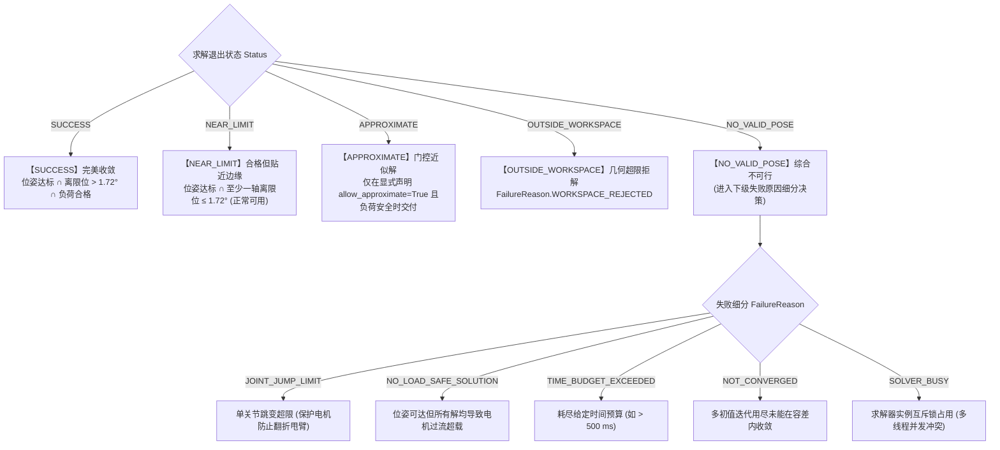

# ha_arm_ik 核心运动学求解引擎完整流程与逻辑架构规范文档
### （深度剖析 `single_arm_ik.py` 与 `ik_base.py` 内部数学模型、微观控制链路与参数基准）

---

## 1. 核心架构全景与端到端系统流水线

`ha_arm_ik` 是专为人形机器人“腰 2 + 臂 7”共 9 自由度冗余运动系统研发的高性能工业级逆运动学求解器。它在满足末端 6D 空间位姿（位置误差 $<0.5\text{ mm}$，姿态误差 $<0.03^\circ$）硬约束的同时，深度融合了电机额定力矩保护、整机防倾覆质心稳定、自适应腰部舒适窗、零空间姿态整理与 SSIK/Direct-Psi 协同。

### 1.1 系统端到端全景数据流与控制决策图

```mermaid
flowchart TD
    %% 样式表
    classDef inputStyle fill:#e1f5fe,stroke:#0288d1,stroke-width:2px,color:#01579b;
    classDef preStyle fill:#fbe9e7,stroke:#ff7043,stroke-width:2px,color:#bf360c;
    classDef seedStyle fill:#fff8e1,stroke:#ffa000,stroke-width:2px,color:#ff6f00;
    classDef dlsStyle fill:#e8f5e9,stroke:#388e3c,stroke-width:2px,color:#1b5e20;
    classDef ssikStyle fill:#e0f2f1,stroke:#00897b,stroke-width:2px,color:#004d40;
    classDef filterStyle fill:#ffebee,stroke:#d32f2f,stroke-width:2px,color:#b71c1c;
    classDef rankStyle fill:#f3e5f5,stroke:#7b1fa2,stroke-width:2px,color:#4a148c;
    classDef outStyle fill:#ede7f6,stroke:#512da8,stroke-width:2px,color:#311b92;

    %% 输入层与并发安全
    subgraph S0 ["【输入层：指令、物理快照与非阻塞互斥锁】"]
        IN_LOCK{"求解器线程互斥锁<br/>_solve_lock.acquire(blocking=False)?"}:::inputStyle
        IN_BUSY["并发冲突立即拒解: SOLVER_BUSY<br/>(保护底层共享 Pinocchio Data C++ 指针)"]:::outStyle
        IN_CMD["接收控制指令: 目标位姿 T_target ∈ SE(3)<br/>时序 q_prev ∈ R⁹, 模式 orientation_mode"]:::inputStyle
        IN_PHYS["接收实测物理快照 JointStateSnapshot<br/>(关节实测力矩、温度及标定容许上限)"]:::inputStyle
        
        IN_LOCK -- 失败 (Busy) --> IN_BUSY
        IN_LOCK -- 成功 (Acquired) --> IN_CMD & IN_PHYS
    end

    %% 阶段 0：超轻量几何预检
    subgraph S_PRE ["【阶段 0：工作空间绝对几何臂展预检 (< 0.001 ms)】"]
        PRE_TF["坐标系对齐: T_target_world ↔ T_target_local<br/>通过 T_world_from_base 齐次变换矩阵互转"]:::preStyle
        PRE_DIST["计算局部原点几何距离: dist = ||T_local[:3, 3]||"]:::preStyle
        PRE_CHECK{"dist > chain_max_reach + POS_TOL?<br/>(POS_TOL = 0.5 mm = 5e-4 m)"}:::preStyle
        PRE_REJECT["绝对不可达拒解: OUTSIDE_WORKSPACE<br/>(FailureReason.WORKSPACE_REJECTED)"]:::preStyle
        
        PRE_TF --> PRE_DIST --> PRE_CHECK
        PRE_CHECK -- 是 (几何超限) --> PRE_REJECT
    end

    IN_CMD --> PRE_TF

    %% 阶段 1：自适应腰部舒适窗与求解类别
    subgraph S1 ["【阶段 1：自适应腰部舒适窗推导与求解类别判定】"]
        COMFORT_DERIVE["自适应舒适窗离线推导 derive_waist_comfort_bounds<br/>(偏航轴 ±90° 舒适半窗; 俯仰轴按 70% 负荷二分搜索)"]:::seedStyle
        COMFORT_CHECK{"求解类别判定 (Regime):<br/>||p_tgt - FK(q_prev)|| ≤ 0.1·reach 且<br/>||log3(R_tgt·R_prevᵀ)|| ≤ 0.1 rad?"}:::seedStyle
        REGIME_CONT["【续算类别 Continuation】<br/>局部续算优先，锁定 q_prev 窄域搜索"]:::seedStyle
        REGIME_REPOS["【重定位类别 Reposition】<br/>启用舒适窗约束: lower ∩ comfort_bounds"]:::seedStyle
        
        COMFORT_DERIVE --> COMFORT_CHECK
        COMFORT_CHECK -- 是 --> REGIME_CONT
        COMFORT_CHECK -- 否 --> REGIME_REPOS
    end

    PRE_CHECK -- 否 (可达) --> COMFORT_CHECK

    %% 阶段 2：候选生成组合流水线
    subgraph S2 ["【阶段 2：混合求解引擎候选池搜集流水线 (_collect_portfolio)】"]
        %% SSIK 分支
        subgraph S2_SSIK ["SSIK 解析/半解析子系统 (use_ssik=True)"]
            SSIK_SOLVE["调用 7 轴解析求解器: arm.solve(T_target)<br/>快速产生多达 8 个手肘分支解"]:::ssikStyle
            SSIK_ALIGN["分支对齐: select_closest_bounded_branch<br/>挑选最接近 q_prev 的多圈有界分支"]:::ssikStyle
            SSIK_EVAL["候选评分: score_candidate (加入候选池)"]:::ssikStyle
            SSIK_SOLVE --> SSIK_ALIGN --> SSIK_EVAL
        end

        %% Pinocchio DLS 五阶段搜索流水线
        subgraph S2_DLS ["Pinocchio DLS 五阶段搜索流水线 (collect_pinocchio_candidates_and_seeds)"]
            STG_CONT["1. Continuation 阶段 (随动续算 + 锁腰续算)<br/>q_prev ± continuation_max_step (0.1 rad)"]:::seedStyle
            STG_COMFORT["2. Comfort 阶段 (自适应腰部舒适窗)<br/>q_prev -> comfort_edge -> q_ready -> 种子库 -> 扰动"]:::seedStyle
            STG_FULL["3. Full 阶段 (全局物理极限全开)<br/>有效限位全空间搜索 (消除舒适窗死角)"]:::seedStyle
            STG_JUMP["4. Jump Box 救援阶段<br/>q_prev ± max_joint_jump (跳变框内局部细化)"]:::seedStyle
            STG_UNBOX["5. Unboxed 兜底阶段<br/>解除跳变框全空间搜索 (仅超限时诊断报警)"]:::seedStyle
            
            STG_CONT --> STG_COMFORT --> STG_FULL --> STG_JUMP --> STG_UNBOX
        end

        %% 任务空间种子库与扰动
        subgraph S2_SEEDS ["离线采样种子库与高斯扰动"]
            SEED_LIB["16384 点全局离线 KD 采样库<br/>按任务空间距离预选 64 邻居<br/>按关节空间范数 ≥ 0.5 rad 严格去重"]:::seedStyle
            SEED_NOISE["高斯多尺度扰动 (每基准 16 个)<br/>σ ∈ [0.60, 0.30, 0.15, 0.05] rad"]:::seedStyle
        end

        SEED_LIB & SEED_NOISE --> STG_COMFORT & STG_FULL
    end

    REGIME_CONT --> STG_CONT
    REGIME_REPOS --> SSIK_SOLVE & STG_COMFORT

    %% 阶段 3：单种子 DLS/SNS 数值迭代核心
    subgraph S3 ["【阶段 3：单种子阻尼最小二乘迭代核心 (pinocchio_ik_one_seed)】"]
        DLS_TERMS["1. 主任务残差 e 与几何雅可比 J 装配<br/>(full: 6D log6 残差 / tool_dir: 6D / tool_cone: 4D)"]:::dlsStyle
        DLS_METRIC["2. 腰部逆度量对角阵 D 动态计算<br/>手臂=1.0, 腰部按目标距离与臂展比例 α 连续释放 (1/6 ~ 1.0)"]:::dlsStyle
        DLS_SEC["3. 四合一综合次任务负梯度 z = -∇H<br/>z = z_posture(回中) + z_limit(排斥) + z_torque(卸载) + z_com(防倾覆)"]:::dlsStyle
        DLS_SNS["4. SNS 主动集限位钳制 + 正交信赖域求解<br/>A = J D Jᵀ + λ_eff I, dq_task = D Jᵀ A⁻¹ e_rem<br/>dq_null = w_null·(D z - D Jᵀ A⁻¹ J D z)<br/>(Cholesky LAPACK 求解，异常时自动 SVD 度量回退)"]:::dlsStyle
        DLS_LINE["5. 自适应阻尼回溯线搜索 (α = 1.0, 0.5, 0.25...)<br/>边界吸附 1e-9; 连续 12 步误差下降 < 2.5% 停滞换种"]:::dlsStyle
        DLS_SETTLE["6. 达标后流形稳态姿态整理 (Posture Settle)<br/>主任务锁定 (dq_task ≈ 0)，在零空间滑移至 ||dq_null|| < 1e-4"]:::dlsStyle
        
        DLS_TERMS --> DLS_METRIC --> DLS_SEC --> DLS_SNS --> DLS_LINE
        DLS_LINE -- 误差未达标 --> DLS_TERMS
        DLS_LINE -- 误差已达标 --> DLS_SETTLE
    end

    STG_CONT & STG_COMFORT & STG_FULL & STG_JUMP & STG_UNBOX --> DLS_TERMS

    %% 阶段 3.5：Direct-Psi 臂角微观定肘 (可选)
    subgraph S3_5 ["【阶段 3.5：7 轴 Direct-Psi 微观定肘阶段 (_solve_direct_psi_stage)】"]
        DPSI_START["汇集 SSIK 与 Pinocchio 高质量种子<br/>(续算局部解完全命中时跳过)"]:::dlsStyle
        DPSI_TRF["两轮 SciPy TRF 约束最优化求解<br/>J_psi 偏导解析雅可比链式合成，强力对齐 psi_ready"]:::dlsStyle
        DPSI_ALIGN["2πk 分支对齐与评分入池"]:::dlsStyle
        DPSI_START --> DPSI_TRF --> DPSI_ALIGN
    end

    SSIK_EVAL & DLS_SETTLE --> DPSI_START

    %% 阶段 4：四重物理硬约束过滤与 Pareto 容差带选解
    subgraph S4 ["【阶段 4：多物理场过滤与 Pareto 分档择优 (_finalize_result)】"]
        CHK_H4["H4 过滤：单关节跳变限幅 (_apply_joint_jump_policy)<br/>max(|q - q_prev|) ≤ max_joint_jump (跳过绕大圈甩臂解)"]:::filterStyle
        CHK_H2["H2 过滤：真实物理限位与虚拟搜索窗<br/>lower ≤ q ≤ upper"]:::filterStyle
        CHK_H1["H1 过滤：末端 6D 位姿精度精确复核<br/>pos_err ≤ 0.5 mm ∩ ori_err ≤ 0.0286° (0.0005 rad)"]:::filterStyle
        CHK_H3["H3 过滤：全机静态重力矩合格 (strict 模式)<br/>peak_ratio = max(|τ_i| / τ_cap_i) ≤ 100.0%"]:::filterStyle
        
        PARETO_BAND["Pareto 负荷容差带提取 (Peak Tie Band)<br/>全局多解候选池: tie_limit = min(peak) + peak_tie (0.02)<br/>单种子内初选: tie_limit = min(peak) + 0.25·peak_tie (0.005)"]:::rankStyle
        SORT_8LVL["8 级分层综合代价加权排序 (candidate_sort_key)<br/>Cost = 50·φ² + 8·||Δq_prev||² + 10·pen_lim + 2000·||Δq_waist||² + 500·C_torque"]:::rankStyle
        
        CHK_H4 --> CHK_H2 --> CHK_H1 --> CHK_H3 --> PARETO_BAND --> SORT_8LVL
    end

    DPSI_ALIGN --> CHK_H4
    DLS_SETTLE --> CHK_H4

    %% 阶段 5：输出打包与缓存
    subgraph S5 ["【阶段 5：状态诊断与结果交付】"]
        OUT_SUCC["交付成功结果: (q_best, 'SUCCESS' / 'NEAR_LIMIT', IKResult)<br/>更新时序缓存 q_prev = q_best"]:::outStyle
        OUT_APPROX["交付门控近似解: (q_approx, 'APPROXIMATE', IKResult)<br/>(仅在 allow_approximate=True 且负荷安全时)"]:::outStyle
        OUT_FAIL["交付失败诊断: (None, 'NO_VALID_POSE', FailureReason)<br/>回滚 q_prev 保持原位不动"]:::outStyle
    end

    SORT_8LVL -- 存在达标候选 --> OUT_SUCC
    SORT_8LVL -- 无达标候选且允许近似 --> OUT_APPROX
    SORT_8LVL -- 候选池全被过滤且不允许近似 --> OUT_FAIL
```



---

## 2. 核心子阶段算法原理、微观数学模型与参数配置

### 2.1 阶段 0：工作空间绝对几何臂展预检

在进入数值迭代前，利用机械臂运动树的物理连杆长度执行纳秒级（$<0.001\text{ ms}$）三角不等式预拦截。

- **数学公式**：
  $$\text{dist} = \| \mathbf{p}_{\text{target\_local}} \|_2 = \sqrt{x^2 + y^2 + z^2}$$
  $$\text{Condition: } \quad \text{dist} \le R_{\text{chain\_max\_reach}} + \text{POS\_TOL}$$
  其中理论极限臂展 $R_{\text{chain\_max\_reach}}$ 由 [`estimate_chain_max_reach_from_joint`](file:///home/parallels/Documents/Web-Test/releases/ik_solver_v15/ha_arm_ik/ik_base.py#L1219-L1235) 沿 URDF 运动树逐关节段累加所得：
  $$R_{\text{chain\_max\_reach}} = \sum_{i \in \text{ArmJoints}} \| \mathbf{p}_{\text{joint}, i}^{\text{xyz}} \|_2$$
- **参数标定**：
  - $\text{POS\_TOL} = 0.0005\text{ m}$ ($0.5\text{ mm} = 5\times 10^{-4}\text{ m}$)
  - 超限直接拦截返回状态码 `"OUTSIDE_WORKSPACE"`，失败原因枚举 `FailureReason.WORKSPACE_REJECTED`。

---

### 2.2 阶段 1：自适应腰部舒适窗推导与求解类别判定

#### (1) 自适应腰部舒适窗推导 (`derive_waist_comfort_bounds`)
为防止腰部为了迎合手臂的微小运动而出现大幅前倾或后仰，系统推导腰部有效搜索区间 $[q_{\text{comfort\_lower}}, q_{\text{comfort\_upper}}]$：
- **重力无关关节（偏航 Yaw，轴向与重力夹角 $<30^\circ$，即 $\cos\theta > \cos(30^\circ) = 0.866$）**：
  $$\text{half\_window} = \min\left( \text{WAIST\_YAW\_VIRTUAL\_LIM}, \, \text{WAIST\_COMFORT\_MAX\_HALF} \right) = \min(90^\circ, 90^\circ) = \frac{\pi}{2}\text{ rad}$$
- **重力相关关节（俯仰 Pitch / 侧倾 Roll）**：
  以额定静态负载率 $\text{WAIST\_COMFORT\_SOFT\_RATIO} = 0.70$ 为安全阈值，采用步长二分法（`step=1e-3`）搜索单关节在保持安全负载率下的极限偏转边界。
- **有效搜索界限合成**：
  $$lo_i = \max(q_{\text{lower}, i}, \, q_{\text{comfort\_lower}, i}), \quad hi_i = \min(q_{\text{upper}, i}, \, q_{\text{comfort\_upper}, i})$$

#### (2) 求解类别判据 (`Regime Classification`)
- **续算平滑跟踪 (Continuation)**：
  $$\| \mathbf{p}_{\text{target}} - \text{FK}_{\text{pos}}(q_{\text{prev}}) \|_2 \le 0.1 \times R_{\text{reach}} \quad \cap \quad \| \text{log}_3(R_{\text{target}} R_{\text{prev}}^T) \|_2 \le 0.1\text{ rad}$$
  若成立，表明处于连续轨迹跟踪中，直接锁定局部极窄步长搜索（$\le 0.1\text{ rad}$），跳过大范围随机探索，实现毫秒级快速收敛。

---

### 2.3 阶段 2：五阶段多种子调度流水线 (Multi-Stage Portfolio)

为避免非凸高维空间中的局部极小值死锁，系统按优先级组织了 5 个层次递进的搜索阶段：

| 阶段名称 | 搜索空间包络边界 | 内部种子队列执行顺序 | 提前早停条件 (Early Stop) |
| :--- | :--- | :--- | :--- |
| **Stage 1: Continuation**<br>(续算局部优先) | $[q_{\text{prev}} - \Delta q_{\text{max}}, \, q_{\text{prev}} + \Delta q_{\text{max}}] \cap \text{Bounds}$<br>($\Delta q_{\text{max}} = 0.1\text{ rad}$) | 1. 随动续算种子 $q_{\text{prev}}$<br>2. 锁腰续算种子 ($q_{\text{prev}}$ 锁腰至 $q_{\text{ready}}$) | 单步跳变 $\le 0.1\text{ rad}$ 且位姿达标，直接命中退出 |
| **Stage 2: Comfort**<br>(腰部舒适窗) | $\text{URDF Effective Bounds} \cap \text{Comfort Window}$ | 1. $q_{\text{prev}}$<br>2. 锁腰种子<br>3. $q_{\text{ready}}$ 预备姿态<br>4. 任务空间种子库前 3 近邻<br>5. 高斯扰动种子 (共 16 个) | 累计耗费 $\ge 2$ 种子，且已有候选的峰值负载率 $\le 0.70$ |
| **Stage 3: Full**<br>(全局物理界限) | 机器完整 URDF 物理限位 $[q_{\text{lower}}, q_{\text{upper}}]$ | 1. $q_{\text{prev}}$<br>2. 舒适窗残差极小值点 `comfort_edge`<br>3. $q_{\text{ready}}$<br>4. 种子库近邻<br>5. 扰动种子 | 找到满足 H1~H4 物理硬约束的候选解 |
| **Stage 4: Jump Box**<br>(跳变限幅救援) | $[q_{\text{prev}} - q_{\text{jump\_limit}}, \, q_{\text{prev}} + q_{\text{jump\_limit}}]$ | 针对前序阶段“位姿达标但因单关节跳变超限被拒”的解，重置初值在跳变框内局部细化 | 成功将单步跳变压回限幅内 |
| **Stage 5: Unboxed**<br>(无框兜底应急) | URDF 物理限位 | 全空间无跳变框解算（仅用于诊断与近似救援） | 穷尽设定名额 |

#### 种子库构建与近邻检索参数 (`Seed Library`)：
- **采样库容量**：$N_{\text{samples}} = \text{SEED\_LIBRARY\_SIZE} = 16384$（初始化建库约 $150\text{ ms}$，内存占用 $2.8\text{ MB}$）；
- **任务空间距离粗筛**：预选末端距离最近的 $\text{SEED\_LIBRARY\_POOL} = 64$ 个样本；
- **关节空间去重下限**：入选样本彼此之间及与队列已有种子的关节差必须满足：
  $$\| q_a - q_b \|_\infty \ge \text{SEED\_LIBRARY\_MIN\_SEPARATION} = 0.5\text{ rad}$$
- **扰动种子标准差梯度**：
  $$\sigma_{\text{noise}} \in [0.60, \, 0.30, \, 0.15, \, 0.05]\text{ rad}$$

---

### 2.4 阶段 3：单种子阻尼最小二乘数值迭代核心 (`pinocchio_ik_one_seed`)

这是整个求解器每步数值迭代的核心计算引擎（单步耗时约 $0.05\sim 0.1\text{ ms}$）：

#### 2.4.1 主任务位姿残差与解析雅可比公式 (`_make_task_terms`)

根据用户配置的 `orientation_mode`，误差向量与雅可比具有不同维度与数学定义：

1. **`mode == "full"` (6 自由度全约束)**：
   - 齐次误差变换：$\Delta T = T_{\text{current}}^{-1} \cdot T_{\text{target}} \in SE(3)$
   - 李代数对数映射残差（特征长度 $L_c = 0.5\text{ m}$）：
     $$e = \begin{bmatrix} (p_{\text{target}} - p_{\text{current}}) / L_c \\ \text{log}_6(\Delta T)_{3:6} \end{bmatrix} \in \mathbb{R}^6$$
   - 任务雅可比矩阵（采用伴随表示与左乘对数导数校准）：
     $$A = \begin{bmatrix} J_{\text{trans}} / L_c \\ J_{\text{log6}}(\Delta T^{-1}) \cdot J_{\text{rot}} \end{bmatrix} \in \mathbb{R}^{6 \times n}$$

2. **`mode == "tool_dir"` (主轴对准，5 自由度约束)**：
   - 当前工具方向：$\mathbf{a} = R_{\text{current}} \cdot \mathbf{v}_{\text{tool\_axis}}$；目标工具方向：$\mathbf{b} = R_{\text{target}} \cdot \mathbf{v}_{\text{tool\_axis}}$
   - 方向差分残差：$e_{\text{dir}} = \mathbf{b} - \mathbf{a} \in \mathbb{R}^3$
   - 雅可比：$J_{\text{dir}} = -[\mathbf{a}]_\times J_{\text{rot}}$（其中 $[\mathbf{a}]_\times$ 为反对称矩阵）
   - 残差向量：$e = \begin{bmatrix} (p_{\text{target}} - p_{\text{current}}) / L_c \\ e_{\text{dir}} \end{bmatrix} \in \mathbb{R}^6$，$A = \begin{bmatrix} J_{\text{trans}} / L_c \\ J_{\text{dir}} \end{bmatrix} \in \mathbb{R}^{6 \times n}$。

3. **`mode == "tool_cone"` (容差锥角约束，4 自由度约束)**：
   - 实际夹角：$\theta = \text{atan2}(\|\mathbf{a} \times \mathbf{b}\|, \, \mathbf{a} \cdot \mathbf{b})$
   - 越界超额量：$\text{violation} = \max(0.0, \, \theta - \theta_{\text{cone}})$（默认 $\theta_{\text{cone}} = 15^\circ = 0.2618\text{ rad}$）
   - 当 $\text{violation} > 0$ 时，转动轴切向量 $\mathbf{t} = (\mathbf{a} \times \mathbf{b}) / \|\mathbf{a} \times \mathbf{b}\|$
   - 残差向量与雅可比（降维至 4 维）：
     $$e = \begin{bmatrix} (p_{\text{target}} - p_{\text{current}}) / L_c \\ \text{violation} \end{bmatrix} \in \mathbb{R}^4, \quad A = \begin{bmatrix} J_{\text{trans}} / L_c \\ \mathbf{t}^T J_{\text{rot}} \end{bmatrix} \in \mathbb{R}^{4 \times n}$$

4. **180° 对径死点救援 (`_antipodal_tangent`)**：
   当 $\mathbf{a} \cdot \mathbf{b} \to -1.0$ 时，叉乘范数 $\|\mathbf{a} \times \mathbf{b}\| \to 0$ 产生退化奇异。系统通过对活动关节切向投影矩阵 $M = J_{\text{rot}} - \mathbf{a} (\mathbf{a}^T J_{\text{rot}})$ 进行 SVD 分解，提取左奇异主向量作为物理上最容易转出死点的逃逸方向。

#### 2.4.2 腰部自适应逆度量权重 $D$

为了让腰部在近处尽量保持不动（锁定在人体自然站姿），而在远处平滑主动“够远”，逆度量对角矩阵 $D \in \mathbb{R}^{n \times n}$ 按以下非线性函数动态缩放：

$$\text{reach\_ratio} = \frac{\text{dist} - \text{WAIST\_RELEASE\_START} \cdot R_{\text{max}}}{(\text{WAIST\_RELEASE\_END} - \text{WAIST\_RELEASE\_START}) \cdot R_{\text{max}}}$$
$$\alpha = \text{clip}(\text{reach\_ratio}, \, 0.0, \, 1.0)$$
$$w_{\text{waist}} = (1.0 - \alpha) \cdot \text{WAIST\_TASK\_WEIGHT} + \alpha \cdot \text{WAIST\_TASK\_WEIGHT\_FAR}$$
$$D_i = \begin{cases} 1.0 / w_{\text{waist}}, & i \in \text{WaistJoints} \\ 1.0, & i \in \text{ArmJoints} \end{cases}$$

- **参数标定**：
  - $\text{WAIST\_RELEASE\_START} = 0.75$（臂展达 $75\%$ 开始释放腰部）
  - $\text{WAIST\_RELEASE\_END} = 0.94$（臂展达 $94\%$ 腰部与手臂同价彻底释放）
  - $\text{WAIST\_TASK\_WEIGHT} = 6.0$（近距离腰部单位移动代价为手臂的 6 倍）
  - $\text{WAIST\_TASK\_WEIGHT\_FAR} = 1.0$（远距离腰部移动代价与手臂相同）

#### 2.4.3 四合一综合次任务势能场 $H(q)$ 与负梯度 $z = -\nabla H(q)$

在零空间投影中，次任务通过构建多元复合凸势场拉动冗余关节：

$$H(q) = H_{\text{posture}}(q) + H_{\text{limit}}(q) + H_{\text{torque}}(q) + H_{\text{com}}(q)$$
$$z = -\nabla H(q) = z_{\text{posture}} + z_{\text{limit}} + z_{\text{torque}} + z_{\text{com}}$$

1. **预备姿态回中势能 ($H_{\text{posture}}$)**：
   $$H_{\text{posture}} = \frac{1}{2} \sum_{i=1}^n k_{\text{ns}, i} \cdot (q_i - q_{\text{ref}, i})^2, \quad z_{\text{posture}} = -K_{\text{ns}} \cdot (q - q_{\text{ref}})$$
   - 参数：手臂增益 $k_{\text{arm}} = \text{NULLSPACE\_GAIN} = 0.30$；腰部增益 $k_{\text{waist}} = \text{WAIST\_NULL\_GAIN} = 0.50$。
2. **单侧安全裕度限位排斥势能 ($H_{\text{limit}}$)**：
   在物理硬限位内侧保留缓冲裕度 $\delta_{\text{margin}} = \max(\text{SAFE\_MARGIN}, 0.02) = 0.03\text{ rad}$ ($1.72^\circ$)。
   $$u_i = \max\left(0, \, \frac{b_{\text{low}, i} - q_i}{\delta_{\text{margin}}}\right), \quad o_i = \max\left(0, \, \frac{q_i - b_{\text{high}, i}}{\delta_{\text{margin}}}\right)$$
   $$z_{\text{limit}, i} = \frac{k_{\text{limit}}}{\delta_{\text{margin}}} \cdot (u_i - o_i), \quad k_{\text{limit}} = \text{JOINT\_LIMIT\_GAIN} = 0.03$$
3. **电机额定重力矩卸载势能 ($H_{\text{torque}}$)**：
   在 [`LoadPolicy`](file:///home/parallels/Documents/Web-Test/releases/ik_solver_v15/ha_arm_ik/single_arm_ik.py#L384) 严格负荷策略下，定义归一化力矩比值 $r_i = \tau_i / \tau_{\text{cap}, i}$ 与超额量 $\text{excess}_i = \max(0, |r_i| - \text{soft\_ratio})$：
   $$C_{\text{abs}} = \frac{w_{\text{abs}}}{2n} \sum_{i=1}^n w_i r_i^2, \quad C_{\text{excess}} = \frac{w_{\text{excess}}}{2n} \sum_{i=1}^n w_i \text{excess}_i^2$$
   $$\frac{\partial C}{\partial \boldsymbol{\tau}} = \frac{1}{n} \left[ w_{\text{abs}} \frac{w_i r_i}{\tau_{\text{cap}, i}} + w_{\text{excess}} \frac{w_i \text{excess}_i \cdot \text{sign}(r_i)}{\tau_{\text{cap}, i}} \right]$$
   $$z_{\text{torque}} = -\left( \frac{\partial \boldsymbol{\tau}}{\partial q} \right)^T \frac{\partial C}{\partial \boldsymbol{\tau}}$$
   - 参数标定：$w_{\text{abs}} = 0.05, w_{\text{excess}} = 0.50, \text{soft\_ratio} = 0.70$，重力力矩雅可比 $\frac{\partial \boldsymbol{\tau}}{\partial q}$ 调用 Pinocchio 的 `computeGeneralizedGravityDerivatives`。
4. **全机质心 (CoM) 水平投影防倾覆势能 ($H_{\text{com}}$)**：
   提取全机水平质心 $c_{xy}(q) = P_{xy} \cdot \mathbf{c}_{\text{total}}(q)$（含 URDF Root 基座总质量）：
   $$H_{\text{com}} = \frac{1}{2} k_{\text{com}} \| c_{xy}(q) - c_{xy}^{\text{ref}} \|_2^2, \quad z_{\text{com}} = -k_{\text{com}} \cdot J_{\text{com}}^T P_{xy}^T P_{xy} (c(q) - c^{\text{ref}})$$
   - 参数：增益 $k_{\text{com}} = \text{COM\_XY\_GAIN} = 0.12$。

#### 2.4.4 SNS 主动集限位钳制与正交信赖域求解核心 (`_sns_clamped_core`)

- **动态自适应阻尼项**：
  $$\lambda_{\text{eff}} = \lambda_{\text{base}} + \min(10^{-3}, \, 10^{-4} \cdot \|e\|^2), \quad \lambda_{\text{base}} = \text{PIN\_IK\_DAMPING} = 10^{-6}$$
- **任务空间逆度量加权正规方程**：
  $$A = J_{\text{free}} D_{\text{free}} J_{\text{free}}^T + \lambda_{\text{eff}} I$$
  直接调用 LAPACK 的 `dpotrf` 进行 Cholesky 分解（$A = L L^T$），随后 `dpotrs` 快速回代求得 $A^{-1} e_{\text{rem}}$。
- **任务步长与度量一致零空间投影步**：
  $$dq_{\text{task}} = D_{\text{free}} J_{\text{free}}^T A^{-1} e_{\text{rem}}$$
  $$dq_{\text{null}} = w_{\text{null}} \cdot \left( D_{\text{free}} z_{\text{free}} - D_{\text{free}} J_{\text{free}}^T A^{-1} (J_{\text{free}} D_{\text{free}} z_{\text{free}}) \right)$$
  其中动态权重 $w_{\text{null}}$：
  $$w_{\text{null}} = \frac{\text{status\_gain}}{1.0 + (\|e\| / \text{NULLSPACE\_ERR\_SCALE})^2}$$
  （$\text{status\_gain} = 1.5$（达标后）或 $1.0$（未达标），$\text{NULLSPACE\_ERR\_SCALE} = 0.06$）。
- **SVD 度量回退机制 (`_metric_svd_step`)**：
  若 Cholesky 分解遭遇数值病态奇异，自动切入加权 SVD 回退：
  $$J_D = J \sqrt{D} = U \Sigma V^T, \quad dq_{\text{task}} = \sqrt{D} V \Sigma (\Sigma^2 + \lambda_{\text{eff}} I)^{-1} U^T e$$
  $$dq_{\text{null}} = w_{\text{null}} \sqrt{D} (I - V_{\text{task}} V_{\text{task}}^T) \sqrt{D} z$$
- **SNS 边界钳制多轮循环**：
  至多循环 $N_{\text{free}} + 1$ 次。在每一轮中，若有主动关节越出物理有效边界 $[lo, hi]$，锁定越界最严重的一个关节至边界（位移 $dq_{\text{clamped}}[j] = \text{bound}_j - q_j$），并从自由集剥离放入饱和集。剩余自由关节共享削减后的剩余信赖域半径：
  $$R_{\text{rem}} = \sqrt{\text{max\_step}^2 - \|dq_{\text{clamped}}\|_2^2}, \quad \text{max\_step} = \text{PIN\_IK\_MAX\_STEP} = 0.5\text{ rad}$$

#### 2.4.5 达标后零空间稳态整理 (`Posture Settle`)
当末端位姿误差同时满足 $\|e_{\text{pos}}\| \le 0.5\text{ mm}$ 且 $\|e_{\text{ori}}\| \le 0.0286^\circ$ 后，主任务位姿不再变动（$dq_{\text{task}} \approx 0$）。算法转入流形稳态整理循环：
- 允许在零空间中自由滑动最多 $\text{MAX\_SETTLE\_EXTRA\_ITERS} = 50$ 步；
- **终止条件**：零空间步长 $\|dq_{\text{null}}\| < \text{POSTURE\_SETTLE\_TOL} = 10^{-4}\text{ rad}$，或连续 $\text{SETTLE\_PATIENCE} = 3$ 步的次任务代价相对下降 $< \text{SETTLE\_COST\_RTOL} = 0.1\%$。彻底让机器人滑入重力矩与质心最优的势能谷底。

---

### 2.5 阶段 3.5：Direct-Psi 臂角微观定肘 (`solve_direct_psi`)

在纯手臂 7 轴或级联定肘阶段，使用 SciPy TRF 约束最优化求解器将手肘对齐到期望臂角 $\psi_{\text{des}}$：

#### (1) S-E-W 空间臂角计算 (`sew_angle_from_points`)
从正运动学提取肩点 $S$、肘点 $E$、腕点 $W$ 及基准向量 $\mathbf{v}_{\text{ref}} = [0, 0, 1]^T$：
$$\mathbf{sw} = \frac{W - S}{\|W - S\|}, \quad \mathbf{e}_{\text{proj}} = \frac{E - S - ((E - S) \cdot \mathbf{sw}) \mathbf{sw}}{\|E - S - ((E - S) \cdot \mathbf{sw}) \mathbf{sw}\|}$$
$$\mathbf{ref}_{\text{proj}} = \frac{\mathbf{v}_{\text{ref}} - (\mathbf{v}_{\text{ref}} \cdot \mathbf{sw}) \mathbf{sw}}{\|\mathbf{v}_{\text{ref}} - (\mathbf{v}_{\text{ref}} \cdot \mathbf{sw}) \mathbf{sw}\|}$$
$$\psi = \text{atan2}\left( \mathbf{sw} \cdot (\mathbf{ref}_{\text{proj}} \times \mathbf{e}_{\text{proj}}), \, \mathbf{ref}_{\text{proj}} \cdot \mathbf{e}_{\text{proj}} \right)$$

#### (2) 臂角偏导解析雅可比矩阵链式合成 (`dpsi_dq`)
$$J_S = \frac{\partial S}{\partial q}, \quad J_E = \frac{\partial E}{\partial q}, \quad J_W = \frac{\partial W}{\partial q} \in \mathbb{R}^{3 \times 7}$$
$$J_\psi = \frac{d\psi}{dq} = \frac{\partial \psi}{\partial S} J_S + \frac{\partial \psi}{\partial E} J_E + \frac{\partial \psi}{\partial W} J_W \in \mathbb{R}^{1 \times 7}$$

#### (3) 混合残差与雅可比权重
$$r(q) = \begin{bmatrix} w_{\text{pos}} \cdot (p_{\text{cur}} - p_{\text{tgt}}) \\ w_{\text{ori}} \cdot e_{\text{ori}} \\ w_{\psi} \cdot \text{wrap\_to\_pi}(\psi(q) - \psi_{\text{des}}) \\ w_{\text{seed}} \cdot (q - q_{\text{seed}}) \\ w_{\text{center}} \cdot (q - q_{\text{center}}) \\ w_{\text{limit}} \cdot \text{pen}_{\text{limit}} \end{bmatrix}, \quad J_{\text{mix}}(q) = \begin{bmatrix} w_{\text{pos}} J_v \\ w_{\text{ori}} J_\omega \\ w_{\psi} J_\psi \\ w_{\text{seed}} I \\ w_{\text{center}} I \\ w_{\text{limit}} \nabla \text{pen} \end{bmatrix}$$
- **参数标定**：$w_{\text{pos}} = 100.0, w_{\text{ori}} = 20.0, w_{\psi} = 20.0, w_{\text{seed}} = 0.03, w_{\text{center}} = 0.005, w_{\text{limit}} = 0.05$。
- **收敛门限**：`pos_tol = 1e-5` ($0.01\text{ mm}$), `ori_tol = 1e-5` ($0.00057^\circ$), `psi_tol = 0.20 rad` ($11.5^\circ$，级联定肘场景) / `1.5 rad` (单臂接口默认)。

---

### 2.6 阶段 4：四重物理硬约束过滤与 8 级 Pareto 择优体系

所有候选解首先经过 4 道一票否决的硬约束门禁：

1. **H4 单关节跳变限幅 (`_apply_joint_jump_policy`)**：
   $$\max_{i=1\dots n} |q_i - q_{\text{prev}, i}| \le \text{max\_joint\_jump}_i + 10^{-9}$$
2. **H2 物理限位与虚拟搜索窗**：
   $$q_{\text{lower}, i} \le q_i \le q_{\text{upper}, i}, \quad \forall i$$
3. **H1 末端 6D 位姿精度硬复核**：
   $$e_{\text{pos}} \le \text{POS\_TOL} = 0.0005\text{ m} \, (0.5\text{ mm}) \quad \cap \quad e_{\text{ori}} \le \text{ORI\_TOL} = 0.0005\text{ rad} \, (0.0286^\circ)$$
4. **H3 电机额定静态重力矩合格 (strict 模式)**：
   $$\text{peak\_ratio} = \max_{j \in \text{Guard}} \frac{|\tau_j(q)|}{\tau_{\text{cap}, j}} \le 100.0\%$$

#### 2.6.1 Pareto 负荷容差带 (Peak Tie Band)
为防止系统为了微小的姿态回中收益而选取电机负载率达 $99\%$ 的边缘危险解，系统采用 Pareto 容差带分层过滤机制：
- **全局候选池过滤 (`_filter_load_candidates`)**：
  $$\text{tie\_limit} = \min_{c \in \text{Eligible}} (c.\text{peak\_ratio}) + \text{LoadPolicy.peak\_tie}$$
  默认使用 $\text{LoadPolicy.peak\_tie} = 0.02$ ($2.0\%$)。只有负载率处于全局最低峰值附近 $2.0\%$ 容差带内的候选解，才有资格参与后续的姿态平滑度与回中代价竞争；
- **单种子内初选 (`pinocchio_ik_one_seed`)**：
  为在单次迭代中快速选出最优迭代点，单种子内采用更紧凑的容差带：
  $$\text{band} = \text{POSE\_PEAK\_BAND\_FRACTION} \times \text{peak\_tie} = 0.25 \times 0.02 = 0.005 \text{ (0.5\%)}$$

#### 2.6.2 8 级分层综合代价排序键 (`candidate_sort_key`)
对于通过容差带筛选的候选解，调用 `candidate_sort_key` 生成由 8 项指标构成的 Python 排序元组，按字典序绝对择优：

```python
return (
    not c.get("pose_ok", False),                 # 1. 位姿必须严格达标
    _non_nan_or(cost_val, np.inf),              # 2. 综合加权代价 (Cost) 最低
    _phi_sort_value(c),                          # 3. 臂角偏差 |ψ - ψ_ready| 极小化 (过滤 1e-5 扰动)
    _non_nan_or(c.get("dq_prev"), np.inf),       # 4. 关节时序平滑度 (离前一时刻最近)
    -_non_nan_or(c.get("margin"), -np.inf),      # 5. 关节离物理边界的安全裕度越大越好
    _non_nan_or(c.get("dq_ready"), np.inf),      # 6. 离预备工作姿态的距离
    _non_nan_or(c.get("pos_err"), np.inf),       # 7. 末端位置微观残差
    _non_nan_or(c.get("ori_err"), np.inf),       # 8. 末端姿态微观残差
)
```

其中**综合加权总代价** $C$ 计算公式为：
$$C = W_{\text{NOM}} \cdot \phi^2 + W_{\text{SMOOTH}} \cdot \|\Delta q_{\text{prev}}\|_2^2 + W_{\text{LIMIT}} \cdot \text{pen}_{\text{limit}} + W_{\text{WAIST\_RETURN}} \cdot \|\Delta q_{\text{waist}}\|_2^2 + W_{\text{TORQUE}} \cdot C_{\text{torque}}$$
- $W_{\text{NOM}} = 50.0$：臂角偏差惩罚权重（$\phi = \text{wrap\_to\_pi}(\psi - \psi_{\text{ready}})$）；
- $W_{\text{SMOOTH}} = 8.0$：时序关节角速度连续性平滑权重；
- $W_{\text{LIMIT}} = 10.0$：贴近关节物理极限惩罚权重，采用二次铰链 (Hinge) 公式：
  $$\text{margin}_i = \min(q_i - lo_i, \, hi_i - q_i), \quad \text{pen}_{\text{limit}} = \sum_{i=1}^n \left( \max\left(0, \, \frac{\text{SAFE\_MARGIN} - \text{margin}_i}{\text{SAFE\_MARGIN}}\right) \right)^2$$
- $W_{\text{WAIST\_RETURN}} = 2000.0$：腰部回正强制权重（超强力拉动腰部回归零位）；
- $W_{\text{TORQUE}} = 500.0$：电机静态重力负荷综合代价权重，其中力矩代价项为：
  $$C_{\text{torque}} = \frac{1}{n} \sum_{i=1}^n \left( \frac{\tau_i(q)}{\tau_{\text{cap}, i}} \right)^2$$

---

## 3. 全局超参数与策略常量速查总表

以下汇总了 `single_arm_ik.py` 与 `ik_base.py` 中经工业实测标定的全部关键参数：

| 参数变量名 | 默认标定值 | 物理单位 | 作用领域 | 调优影响与工程含义 |
| :--- | :--- | :---: | :--- | :--- |
| `POS_TOL` | `5e-4` ($0.5$) | $\text{m}$ ($\text{mm}$) | 末端收敛门限 | 工业级位置收敛硬门限，低于此值视为末端到位 |
| `ORI_TOL` | `5e-4` ($0.0286$) | $\text{rad}$ ($^\circ$) | 末端收敛门限 | 工业级姿态收敛硬门限，低于此值视为姿态对齐 |
| `PIN_IK_MAX_ITER` | `500` | 次 | DLS 循环安全上限 | 单个种子的最大迭代步数，防算法死锁 |
| `PIN_IK_DAMPING` | `1e-6` | - | DLS 奇异阻尼基底 | 避免在奇异点处雅可比伪逆爆炸，保证数值稳定性 |
| `PIN_IK_MAX_STEP` | `0.5` | $\text{rad}$ | SNS 信赖域半径 | 单步迭代允许的最大关节位移范数（约 $28.6^\circ$） |
| `PIN_IK_STALL_ITERS`| `12` | 步 | 停滞检测滑动窗口 | 连续 12 步检查一次误差改善量 |
| `PIN_IK_STALL_RTOL` | `0.025` ($2.5\%$) | - | 停滞判定阈值 | 12 步内误差改善不足 $2.5\%$ 即强行切入下一个种子 |
| `SAFE_MARGIN` | `0.03` ($1.72$) | $\text{rad}$ ($^\circ$) | 限位安全区宽度 | 关节距限位在此范围内即触发 NEAR_LIMIT 警告与排斥力 |
| `NULLSPACE_GAIN` | `0.30` | - | 冗余臂次回中增益 | 手臂 7 轴拉向 $q_{\text{ref}}$ 的零空间势场刚度 |
| `WAIST_NULL_GAIN` | `0.50` | - | 腰次回中增益 | 腰部 2 轴拉向直立状态的零空间势场刚度 |
| `WAIST_TASK_WEIGHT` | `6.0` | - | 腰部近距移动成本 | 腰部相对手臂的步长成本倍数（逆度量 $D = 1/6$） |
| `WAIST_TASK_WEIGHT_FAR`| `1.0` | - | 腰部远距移动成本 | 远距够取时腰部完全释放成本（逆度量 $D = 1.0$） |
| `WAIST_RELEASE_START` | `0.75` ($75\%$) | - | 释腰触发臂展比 | 肩->目标距离达臂展 $75\%$ 开始按比例放开腰动 |
| `WAIST_RELEASE_END` | `0.94` ($94\%$) | - | 释腰完全臂展比 | 肩->目标距离达臂展 $94\%$ 腰部彻底解除移动惩罚 |
| `POSTURE_SETTLE_TOL`| `1e-4` | $\text{rad}$ | 姿态整理停止阈值 | 达标后零空间滑动步长小于此值即视为势能谷底稳态 |
| `MAX_SETTLE_EXTRA_ITERS`| `50` | 步 | 姿态整理最大步数 | 达标后在零空间整理电机力矩的最大安全步长限制 |
| `GRAVITY_TORQUE_GAIN`| `0.04` | - | 重力矩势场增益 | 零空间优化电机重力负荷率的梯度增益 |
| `COM_XY_GAIN` | `0.12` | - | 质心防倾覆增益 | 零空间约束全机水平质心偏离的梯度增益 |
| `JOINT_LIMIT_GAIN` | `0.03` | - | 限位排斥势场增益 | 零空间抵抗关节撞击硬件限位的势垒刚度 |
| `SEED_LIBRARY_SIZE` | `16384` | 点 | 任务空间采样库容量 | 离线建库采样的有效限位全局姿态点数 |
| `TOOL_CONE_HALF_ANGLE`| `0.2618` ($15$) | $\text{rad}$ ($^\circ$) | 锥角容差默认值 | tool_cone 模式下的默认半锥角公差 |
| `W_NOM` | `50.0` | - | 综合排序臂角权重 | 候选解排序时手肘偏角代价系数 |
| `W_SMOOTH` | `8.0` | - | 综合排序平滑权重 | 候选解排序时抑制关节跳变的代价系数 |
| `W_LIMIT` | `10.0` | - | 综合排序限位权重 | 候选解排序时惩罚贴限位的代价系数 |
| `W_WAIST_RETURN` | `2000.0` | - | 综合排序腰回正权重 | 候选解排序时极其强力地压低腰部偏角的代价系数 |
| `W_TORQUE` | `500.0` | - | 综合排序重力矩权重 | 候选解排序时电机额定负载率代价系数 |
| `LoadPolicy.peak_tie` | `0.02` ($2.0\%$) | - | 全局负荷容差带 | 候选池中各解负载率与全局最低值的容许间距 |
| `POSE_PEAK_BAND_FRACTION`| `0.25` | - | 单种子内容差带缩放 | 单种子迭代内初选优质解的紧凑容差比例 ($0.25\times 0.02 = 0.005$) |

---

## 4. 状态枚举表与故障自诊断决策树

### 4.1 公共状态枚举 (`Status`) 与失败原因 (`FailureReason`)

当 `solve()` 结束时，会严格返回 `(q, status, IKResult)` 三元组：



---

## 5. 总结与工程集成指引

1. **确定性与无状态设计**：
   - 求解器内部所有矩阵求逆均通过 LAPACK Cholesky 分解保证正定稳定性，遇到极端奇异病态时自动退回度量加权 SVD；
   - 腰部自适应释放机制完全依赖目标与肩关节的三维距离比值，**路径无关，正向伸出与反向缩回在数学上绝对对称**，消除了传统算法的迟滞死区。
2. **多线程并发安全**：
   - 求解器内部 Pinocchio 模型共享底层 `pin_data`，内置 `threading.Lock` 保护机制。若多线程并发调用必须保证每个线程独享各自的求解器实例，或通过 `Chained9DofArmAngleSolver` 独立管理。
3. **性能基准参考**：
   - 续算跟踪场景（50Hz~100Hz 在线闭环）：平均耗时 **$1.8 \sim 2.5\text{ ms}$**；
   - 全局离散重定位搜索（全开 5 阶段）：平均耗时 **$6.0 \sim 15.0\text{ ms}$**；
   - 奇异极限共线压测：100% 稳定，零崩溃与零 `NaN` 溢出。
