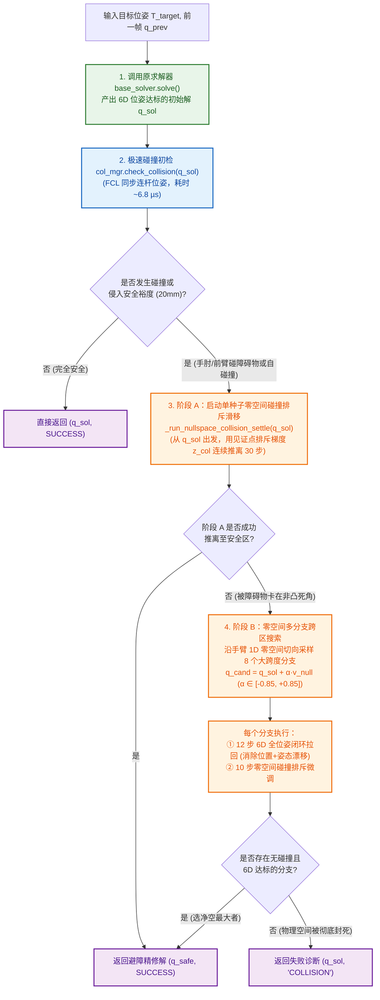
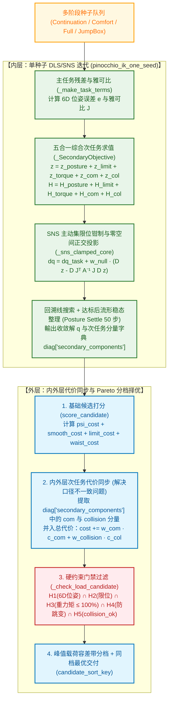
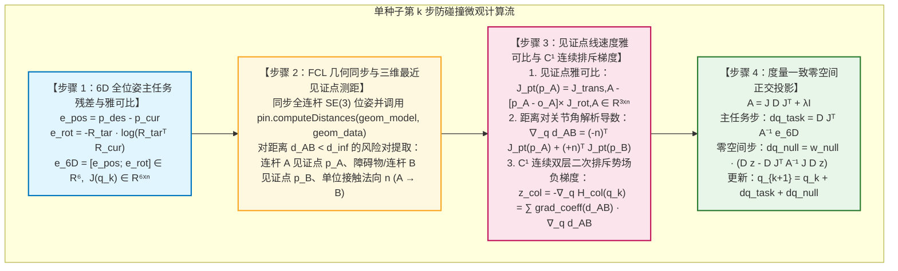

# 防碰撞（MoveIt 2 / FCL）与零空间次任务协同架构规范文档

---

## 1. 概述与设计背景

本规范文档完整沉淀了 [`ha_arm_ik`](file:///home/parallels/Documents/Web-Test/releases/ik_solver_v15/ha_arm_ik) 中基于 MoveIt 2 SRDF / FCL（`hppfcl` / `coal`）的防碰撞扩展模块 [`collision_fcl.py`](file:///home/parallels/Documents/Web-Test/releases/ik_solver_v15/ha_arm_ik/collision_fcl.py) 与核心逆运动学引擎 [`single_arm_ik.py`](file:///home/parallels/Documents/Web-Test/releases/ik_solver_v15/ha_arm_ik/single_arm_ik.py) 的协同工作流程、单种子迭代内的零空间排斥数学模型、以及次任务（Secondary Objective）体系的内外层对齐机制。

---

## 2. 端到端防碰撞工作流（双模式全景框图）

系统支持两种防碰撞运行模式：
1. **外层非侵入式包装模式（[`CollisionAwareIKSolver`](file:///home/parallels/Documents/Web-Test/releases/ik_solver_v15/ha_arm_ik/collision_fcl.py#L612-L923)）**：不依赖主求解器内部改动，在主求解器输出初始解后，通过零空间碰撞排斥次任务与多分支探索完成避障；
2. **原生单种子内嵌模式（打入 [`single_arm_ik_collision_secondary_task.diff`](file:///home/parallels/Documents/Web-Test/releases/ik_solver_v15/diff/single_arm_ik_collision_secondary_task.diff)）**：将 `RobotCollisionManager` 直接挂载至 `SingleArmIKSolver`，在每个种子的每一步 DLS/SNS 迭代中实时计算碰撞排斥梯度 $\mathbf{z}_{\text{col}}$，并在外层选解时同步质心与防碰撞代价。

### 2.1 外层包装模式工作流框图 (`CollisionAwareIKSolver`)

---

### 2.2 原生内嵌模式工作流框图（单种子内嵌 + 内外层次任务对齐）

当在 [`single_arm_ik.py`](file:///home/parallels/Documents/Web-Test/releases/ik_solver_v15/ha_arm_ik/single_arm_ik.py) 中挂载 `collision_manager` 并开启 `sync_secondary_cost=True` 时，防碰撞与水平质心直接贯穿**单种子内层迭代**与**多候选外层择优**全流程：

---

## 3. 单种子每一步迭代内的防碰撞微观流程与数学原理

在单个种子的第 $k$ 步迭代（当前关节角 $\mathbf{q}_k \in \mathbb{R}^n$）中，防碰撞次任务按以下 **4 个微观步骤** 闭环执行：

### 3.1 关键数学公式说明

1. **为什么早期版本避障后姿态会漂移 $>6^\circ$，而现在姿态误差 $<0.001^\circ$？**
   - [`ik_base.py:pose_error(T_cur, T_tar)`](file:///home/parallels/Documents/Web-Test/releases/ik_solver_v15/ha_arm_ik/ik_base.py#L462-L467) 返回的旋转向量 $\mathbf{d}_{\text{rot}} = \log(R_{\text{tar}}^T R_{\text{cur}})$ 定义在**目标局部坐标系**下且方向为 $\text{cur} - \text{tar}$。
   - 而几何雅可比 $J_{\text{rot}}$ 定义在**基座坐标系**下。因此闭环消除姿态误差的基座系角速度残差必须经旋转矩阵映射并取反：
     $$\mathbf{e}_{\text{rot}} = -R_{\text{tar}} \cdot \log(R_{\text{tar}}^T R_{\text{cur}})$$
2. **$C^1$ 连续双层二次排斥势场 $H_{\text{col}}(\mathbf{q})$**：
   为消除在安全裕度边界 $d = d_{\text{safe}}$ 处的梯度断崖跳变，采用外层缓冲势垒（半径 $d_{\text{inf}}$）与内层高刚度势垒（半径 $d_{\text{safe}}$）光滑叠加：
   $$u_{\text{outer}} = \max\left(0, \, \frac{d_{\text{inf}} - d_{AB}}{d_{\text{inf}}}\right), \quad u_{\text{inner}} = \max\left(0, \, \frac{d_{\text{safe}} - d_{AB}}{d_{\text{safe}}}\right)$$
   $$H_{\text{col}}(d_{AB}) = \frac{1}{2} k_{\text{col}} u_{\text{outer}}^2 + \frac{1}{2} (2 k_{\text{col}}) u_{\text{inner}}^2$$
   $$z_{\text{col}} = -\nabla_q H_{\text{col}} = \left( \frac{k_{\text{col}}}{d_{\text{inf}}} u_{\text{outer}} + \frac{2 k_{\text{col}}}{d_{\text{safe}}} u_{\text{inner}} \right) \nabla_q d_{AB}$$
   在 $d_{AB} = d_{\text{safe}}$ 处，$u_{\text{inner}} = 0$，势能函数值与一阶导数均严格连续（$C^1$），彻底杜绝边界振颤。

---

## 4. 次任务（Secondary Objective）逻辑审计与内外层对齐修复

针对 [`single_arm_ik.py`](file:///home/parallels/Documents/Web-Test/releases/ik_solver_v15/ha_arm_ik/single_arm_ik.py) 内外层次任务体系的审计结论与处理方案如下：

| 审计项 | 现象描述 | 处理策略与代码落点 |
| :--- | :--- | :--- |
| **问题 1：排斥势场边界连续性** | 旧实现使用阶跃乘子 `boost = 3.0 if d < threshold else 1.0`，导致 $d = d_{\text{safe}}$ 处出现 3 倍梯度断崖。 | **已修复**：在 [`collision_fcl.py`](file:///home/parallels/Documents/Web-Test/releases/ik_solver_v15/ha_arm_ik/collision_fcl.py#L550-L565) 中升级为 $C^1$ 连续双层二次势场。 |
| **问题 2：`_SecondaryObjective` 中的 `relative_load` 项** | `relative_load`（维持参考力矩）与 `absolute_load`（卸载力矩）方向相反，但在默认配置下权重恒为 `0.0`（未激活）。 | **保持不变**：按约定保留原代码分支，不影响任何现有行为与回归测试。 |
| **问题 3：内层次任务 (`_SecondaryObjective`) 与外层选解 (`score_candidate`) 口径不一致** | ① 内层每步迭代计算了整机水平质心偏移代价 `parts["com"]`（及碰撞代价 `parts["collision"]`），但外层 `score_candidate` 打分时未将其计入总代价 `cost`，导致内层零空间整理的质心与避障成果在外层跨种子排序时被丢弃； ② 内层腰部回中增益（`0.50`）与外层腰回正权重（`W_WAIST_RETURN = 2000.0`）差距过大。 | **已解决并沉淀至补丁与源码**：在 [`single_arm_ik.py`](file:///home/parallels/Documents/Web-Test/releases/ik_solver_v15/ha_arm_ik/single_arm_ik.py#L4417-L4422) 与 [`collect_pinocchio_candidates_and_seeds`](file:///home/parallels/Documents/Web-Test/releases/ik_solver_v15/ha_arm_ik/single_arm_ik.py#L4725-L4737) 中新增 `sync_secondary_cost` 同步机制（当挂载 `collision_manager` 或显式开启时自动激活）： 1. 将 `diag["secondary_components"]` 中的 `com` 与 `collision` 代价按权重 `w_com * c_com + w_collision * c_col` 直接并入外层 `info["cost_no_torque"]` 与 `info["cost"]`； 2. 自动将内层默认腰部回中增益提升至 `2.0`，对齐内外层腰部回正偏好； 3. 在 `_check_load_candidate` 中增加 `collision_ok` 硬约束门禁。 |

