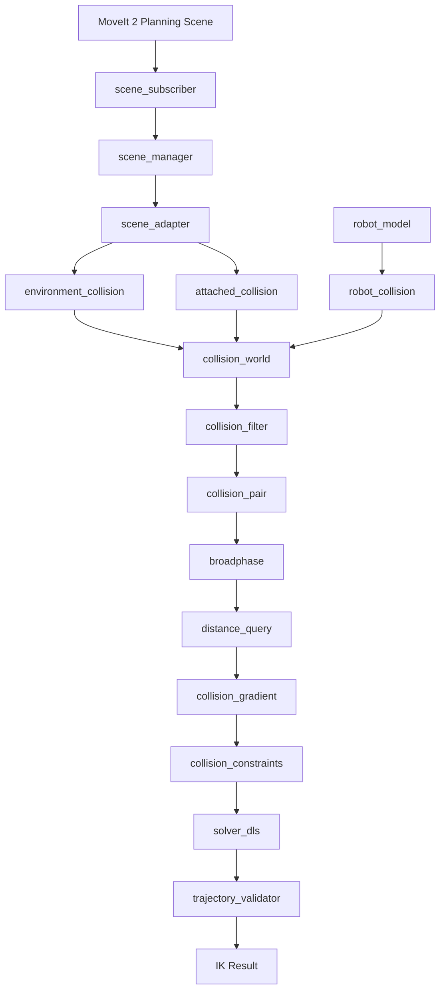

是的，上一版的 `collision` 目录过于精简了。它只覆盖了最基本的场景接入和距离查询，没有完整覆盖碰撞检测、距离梯度、碰撞策略、动态障碍物、附着物体和安全验证。

但也没必要拆成十几个零散文件。我建议采用一个相对完整、职责清晰的结构，全部使用 Python，不引入 C++。

### 一、推荐的完整文件架构

保留现有 IK 核心，只扩展场景管理和碰撞模块。

```text
pinocchio_ik/
│
├── solver.py
├── solver_dls.py
├── robot_model.py
│
├── scene/
│   ├── scene_subscriber.py       # 订阅 MoveIt PlanningScene
│   ├── scene_manager.py          # 场景状态管理
│   ├── scene_adapter.py          # MoveIt 消息解析与转换
│   └── scene_config.py           # 场景及坐标系配置
│
├── collision/
│   ├── collision_world.py       # 碰撞世界统一管理
│   ├── robot_collision.py       # 机器人碰撞几何体管理
│   ├── environment_collision.py # 环境障碍物管理
│   ├── attached_collision.py    # 附着物体管理
│   │
│   ├── geometry_factory.py      # 创建 Box / Sphere / Mesh 等
│   ├── geometry_cache.py        # 几何体缓存
│   │
│   ├── collision_filter.py      # SRDF / ACM / 允许碰撞过滤
│   ├── collision_pair.py        # 碰撞对管理
│   │
│   ├── broadphase.py            # AABB 粗筛
│   ├── distance_query.py        # 精确距离查询
│   ├── collision_gradient.py    # 距离梯度计算
│   │
│   ├── collision_constraints.py # 避障约束与安全距离
│   ├── collision_policy.py      # 碰撞策略与任务状态
│   └── trajectory_validator.py # 候选构型及轨迹安全验证
│
├── config/
│   ├── collision.yaml
│   └── scene.yaml
│
└── tests/
    ├── test_scene_sync.py
    ├── test_geometry.py
    ├── test_collision_pairs.py
    ├── test_distance.py
    ├── test_gradient.py
    ├── test_attached_object.py
    └── test_performance.py
```

### 二、Collision 目录各模块的具体职责

我把它分成五个层次。

### 1\. 碰撞几何体管理层

负责管理碰撞对象

| 文件                       | 主要职责                   |
| ------------------------ | ---------------------- |
| collision_world.py       | 管理整个碰撞世界，统一协调其他模块      |
| robot_collision.py       | 管理机器人全部碰撞 Mesh、位姿和几何索引 |
| environment_collision.py | 管理 MoveIt 中的桌面、墙壁、障碍物等 |
| attached_collision.py    | 管理抓取后附着在机器人 Link 上的物体  |
| geometry_factory.py      | 将 ROS 几何描述转换成 Coal 几何体 |
| geometry_cache.py        | 缓存已加载几何体，避免重复构建        |

这里最重要的是区分三种对象：

* Robot Geometry：机器人自身的碰撞几何体。

* Environment Geometry：环境障碍物。

* Attached Geometry：附着在机器人身上的物体。

三者都参与碰撞计算，但位姿更新方式不同。

### 2\. 碰撞关系管理层

负责决定检查哪些 Pair

| 文件                  | 主要职责                    |
| ------------------- | ----------------------- |
| collision_filter.py | 根据 SRDF、ACM 和任务规则过滤碰撞关系 |
| collision_pair.py   | 管理机器人自碰撞对、机器人与环境碰撞对     |

这里要特别注意：

你的 639 对自碰撞关系属于机器人自身的碰撞关系，应该独立保留。

环境障碍物加入后，还需要增加：

P_{\\text{environment}}
=
P_{\\text{robot}\\leftrightarrow\\text{environment}}

而不是重新生成全部机器人自碰撞对。

`collision_pair.py` 还应该负责 Pair 的启用、停用、增删和索引管理。

### 3\. 碰撞检测计算层

核心计算模块

| 文件                    | 主要职责                 |
| --------------------- | -------------------- |
| broadphase.py         | AABB 粗筛，排除可以证明安全的碰撞对 |
| distance_query.py     | 对候选 Pair 计算精确距离      |
| collision_gradient.py | 根据最近点和机器人雅可比计算距离梯度   |

计算流程：

\\text{All Geometry}
\\rightarrow
\\text{Broad Phase}
\\rightarrow
\\text{Candidate Pairs}
\\rightarrow
\\text{Narrow Phase}
\\rightarrow
d_i,\\ J_{d_i}

其中：

* Broad Phase 不负责最终碰撞判定。

* Distance Query 不负责管理场景。

* Collision Gradient 不负责修改 IK 结果。

这三个模块应该保持独立，方便单独测试和性能优化。

### 4\. 避障决策层

负责向 IK 提供避障信息

| 文件                       | 主要职责                  |
| ------------------------ | --------------------- |
| collision_constraints.py | 计算安全距离、距离约束、碰撞代价      |
| collision_policy.py      | 处理抓取阶段、允许接触、动态障碍物安全策略 |
| trajectory_validator.py  | 检查 DLS 候选结果和轨迹是否安全    |

这里需要区分：

Collision Gradient 是运动学计算，Collision Policy 是任务规则。

例如抓取过程中：

* Approach：所有手指都需要避障。

* Grasp：允许指定手指与目标物体接触。

* Transport：附着物体也参与环境避障。

* Release：恢复普通环境障碍物管理。

不能因为手指允许接触目标物体，就把整个手部的碰撞检测关闭。

### 5\. 场景接入层

这一层放在 `scene/`，而不是混进碰撞计算模块。

| 文件                  | 主要职责                                           |
| ------------------- | ---------------------------------------------- |
| scene_subscriber.py | 接收 MoveIt 2 的 PlanningScene 消息                 |
| scene_manager.py    | 管理场景版本、缓存和更新                                   |
| scene_adapter.py    | 解析 CollisionObject、AttachedCollisionObject、ACM |
| scene_config.py     | 管理 Planning Frame、TF 和同步参数                     |

这样碰撞算法不需要知道 ROS 消息的具体格式。

### 三、各模块之间的完整调用关系



### 四、哪些模块应该在每个 IK 周期执行？

这一点直接关系到你的实时性能。

| 模块                    | 执行时机              |
| --------------------- | ----------------- |
| scene_subscriber      | 收到 ROS 消息时        |
| scene_manager         | 场景更新时             |
| scene_adapter         | 场景消息变化时           |
| geometry_factory      | 新增或修改几何形状时        |
| geometry_cache        | 几何体创建或查找时         |
| robot_collision       | 每轮更新机器人构型时        |
| environment_collision | 环境位姿变化时           |
| attached_collision    | 机器人构型或附着状态变化时     |
| collision_filter      | 场景、ACM 或任务策略变化时   |
| collision_pair        | Pair 集合变化时        |
| broadphase            | 每轮碰撞检测时           |
| distance_query        | 候选 Pair 更新后或每轮迭代时 |
| collision_gradient    | 避障梯度需要更新时         |
| collision_constraints | 每轮 IK 避障计算时       |
| collision_policy      | 策略变化或约束计算时        |
| trajectory_validator  | 候选解或轨迹生成后         |

这里有一个重要优化：场景变化不等于几何结构变化，机器人运动也不等于环境几何体需要重建。

例如桌子没有移动，就不应该反复处理桌子的 Mesh；机器人手臂运动，也不应该重新加载 52 个机器人 Mesh。

### 五、我的最终建议：完整架构，但分阶段实现

上面是建议的最终模块边界，不代表现在就要全部写完。

| 开发阶段 | 实现文件                                                                                     | 目标                     |
| ---- | ---------------------------------------------------------------------------------------- | ---------------------- |
| 第一阶段 | scene_subscriber、scene_manager、scene_adapter、collision_world、geometry_factory            | MoveIt 障碍物进入 Pinocchio |
| 第二阶段 | robot_collision、environment_collision、attached_collision、collision_pair、collision_filter | 完整碰撞对象和 Pair 管理        |
| 第三阶段 | geometry_cache、broadphase、distance_query                                                 | 性能优化                   |
| 第四阶段 | collision_gradient、collision_constraints、collision_policy、trajectory_validator           | 接入 DLS 避障              |

我的判断：这版结构比较适合你的项目。 它覆盖了完整的场景管理、碰撞几何、碰撞对、粗精检测、距离梯度和安全验证，同时没有引入 C++，也没有把现有 DLS 求解器推倒重写。

另外，`collision_world.py` 应该作为唯一的碰撞系统总入口，其他模块由它组织；`solver_dls.py` 只调用它提供的接口，不直接操作底层 GeometryModel 和 CollisionPair。


思考了 27s

根据你的控制方式，碰撞避障不能再简单地理解为“机械臂末端绕开障碍物”。你实际上需要的是一个上半身全构型、全碰撞几何体参与的实时避障系统：

* 9-DoF 腰部与双臂共同参与 IK。

* 灵巧手关节也参与控制，手指运动会改变碰撞几何体的位置。

* 机器人全部碰撞 Mesh 都需要纳入自碰撞和环境碰撞检查。

* 环境中同时存在静态障碍物、动态障碍物和抓取目标。

* 保留 Pinocchio 3.x + DLS，不替换成 Pink QP 或 MoveIt IK。

我建议把它设计成三个相互独立的层次：

* Collision World： 管理机器人碰撞几何体和环境障碍物。

* Collision Monitor： 快速筛选危险碰撞对，并计算距离和梯度。

* DLS Avoidance： 将避障梯度作为现有 IK 的次级任务。

其中最重要的设计原则是：所有几何体都纳入安全检查，但只有当前需要的碰撞对才执行高成本精确距离查询。

### 1\. 先确定完整的运动学变量

这里有一个容易造成架构错误的地方：9-DoF 上半身和灵巧手关节不应该混为一谈，但它们都必须进入碰撞检测的构型计算。

我建议把整个机器人构型分成三组：

| 变量组    | 包含关节            | 在系统中的作用     |
| ------ | --------------- | ----------- |
| 上半身 IK | 腰部 + 双臂，共 9 DoF | 主要 IK 求解变量  |
| 灵巧手    | 左右手各自的手指关节      | 手指姿态及抓取控制变量 |
| 其他固定关节 | 不参与当前 IK 的关节    | 保持当前实际关节状态  |

统一构成 Pinocchio 的完整配置：

q_{\\mathrm{full}}=
\\begin{bmatrix}
q_{\\mathrm{waist}}\\\\
q_{\\mathrm{arms}}\\\\
q_{\\mathrm{hands}}\\\\
q_{\\mathrm{fixed}}
\\end{bmatrix}

需要特别注意：

灵巧手不一定要加入上半身的 DLS 主任务，但必须参与正运动学和碰撞检测。

例如，DLS 更新上半身时，手指可以保持当前指令姿态；如果手指也在同步闭合，则应使用最新手指构型计算碰撞。

这样就不会出现上半身 IK 认为安全，但手指实际上已经撞上障碍物的情况。

### 2\. Collision World：统一管理机器人与环境

我建议将场景分成三个独立集合。

Robot Collision Model


机器人本体

躯干、腰部、左右手臂、手掌、所有手指。使用 Pinocchio GeometryModel 管理。

Static Environment


静态环境

地面、桌面、墙壁、固定 Box 障碍物。位姿不随时间变化，AABB 可以缓存。

Dynamic Environment


动态环境

移动障碍物、人员、其他机器人、运动中的物体。持续更新位置和速度。

建议不要把动态环境物体的状态直接混进机器人关节模型。

可以独立维护：

```python
class CollisionWorld:
    robot_geometry_model
    robot_geometry_data

    static_obstacles
    dynamic_obstacles

    attached_objects
    allowed_collision_matrix
```

这样可以保留现有 Pinocchio 机器人模型，同时独立更新环境。

### 三类几何体之间的碰撞关系

| 碰撞关系                        | 检测策略          |
| --------------------------- | ------------- |
| Robot ↔ Robot               | SRDF 过滤后的自碰撞对 |
| Robot ↔ Static Environment  | 全机器人与静态障碍物    |
| Robot ↔ Dynamic Environment | 全机器人与动态障碍物    |
| Robot ↔ Attached Object     | 按附着关系更新       |
| Robot ↔ Grasp Target        | 按抓取阶段管理允许接触关系 |

注意，环境障碍物的数量发生变化时，机器人与环境的碰撞对数量也会变化。原来的 639 对不一定是以后整个场景的固定总数。

Pinocchio 官方提供 GeometryModel、GeometryData 和 SRDF 过滤流程，适合作为机器人自碰撞模型的基础。GitHub +1

### 3\. Collision Monitor：实时筛选全部碰撞关系

这是解决你 500 ms 问题的核心。

我建议分成三个计算层级。

### 第一级：Broad Phase，全局粗筛

所有 52 个机器人 Mesh 都参与。

每次机器人构型变化：

```python
pin.updateGeometryPlacements(
    model,
    data,
    geom_model,
    geom_data,
    q_full,
)
```

获取几何体世界位姿，再更新世界 AABB。

环境物体的处理方式不同：

* 静态物体：只在初始化时计算一次。

* 动态物体：在收到新位置时更新。

* 附着物体：根据末端 Link 的位姿更新。

接着对所有允许检测的碰撞对计算 AABB 距离下界。

d_{\\mathrm{lower}}(A,B)
\\leq d_{\\mathrm{actual}}(A,B)

设定：

d_{\\mathrm{threshold}}
=
d_{\\mathrm{safe}}+
d_{\\mathrm{uncertainty}}+
d_{\\mathrm{motion}}

满足：

d_{\\mathrm{lower}}\\leq d_{\\mathrm{threshold}}

才进入下一层。

这里的运动余量要覆盖检测间隔内可能产生的相对位移，尤其是动态障碍物。

### 第二级：Narrow Phase，精确距离

只对 Broad Phase 筛选出的碰撞对执行：

```python
result = pin.computeDistance(
    geom_model,
    geom_data,
    pair_id,
)

distance = result.min_distance
```

如果需要梯度，启用最近点信息。

注意：动态环境对象如果不在 Pinocchio GeometryModel 中，就需要单独通过 Coal 距离接口或将其注册到统一的几何场景中，不能直接把外部对象的 pair_id 传给 Pinocchio。

### 第三级：Collision Constraint，构造避障约束

对于进入安全距离范围的碰撞对，记录：

```python
{
    "pair_id": pair_id,
    "distance": distance,
    "nearest_point_robot": p_robot,
    "nearest_point_obstacle": p_obstacle,
    "normal": normal,
    "active": True,
}
```

后续根据两个最近点对应的 Link，获取 Pinocchio 的点 Jacobian。

这样才能将碰撞距离转换为关节空间的避障梯度。

### 4\. 关键设计：候选碰撞对必须有时间连续性

这里我建议你不要每一帧都完全从零开始建立候选集合。

使用一个动态活跃集合：

\\mathcal{C}_{t}
=
\\mathcal{C}_{\\mathrm{new}}
\\cup
\\mathcal{C}_{\\mathrm{previous}}

其中：

* `C_new`：本轮 Broad Phase 新发现的候选碰撞对。

* `C_previous`：上一轮尚未解除的活跃碰撞对。

对于活跃碰撞对设置进入和退出阈值：

d_{\\mathrm{enter}}>d_{\\mathrm{exit}}

例如：

* 进入阈值：80 mm。

* 退出阈值：100 mm。

这只是示意参数，最终要根据机器人尺寸、速度和控制周期确定。

这样做有两个好处：

* 避免碰撞对在阈值附近频繁激活、停用。

* 保证正在参与避障的碰撞对不会因为轻微位姿变化而突然从集合中消失。

但必须强调：滞回只能改善连续性，不能代替保守的运动范围筛选。每一轮都仍然需要检查新进入范围的碰撞对。

### 5\. DLS：避障作为次级任务，但要有安全保护

你当前的 DLS 主任务应该继续保持原样：

e_{\\mathrm{task}}=
\\begin{bmatrix}
e_p\\\\
e_R
\\end{bmatrix}

原有主任务更新：

\\Delta q_{\\mathrm{task}}=J^\\#e_{\\mathrm{task}}

避障则根据活跃碰撞对计算。

对于碰撞对 ，设：

d_i=d_i(q)

距离梯度：

J_{d_i}=\\frac{\\partial d_i}{\\partial q}

可以构造一个距离势函数：

E_i=
\\frac{1}{2}k_i
\\left\[\\max(0,d_{\\mathrm{safe},i}-d_i)\\right\]^2

对应的避障方向：

g_i=
k_i\\max(0,d_{\\mathrm{safe},i}-d_i)J_{d_i}^{T}

组合成：

g_{\\mathrm{collision}}=\\sum_i g_i

然后加入原有 DLS：

\\boxed{
\\Delta q =
J^\\#e_{\\mathrm{task}}
-
\\lambda N g_{\\mathrm{collision}}
}

其中：

N=I-J^\\#J

这里有两个与你的工程直接相关的问题。

第一：DLS 的阻尼零空间不是真正的严格零空间。

因此避障项可能影响末端精度。每次更新后必须重新计算末端误差，必要时降低避障步长。

第二：零空间避障不能保证硬安全约束。

例如手臂已经非常靠近桌面，末端任务又要求继续向桌面方向运动，单纯的零空间梯度可能无法阻止碰撞。

因此我建议增加一个轻量的安全过滤层：

* 先由 DLS 产生候选关节增量。

* 对候选增量进行关节步长限制。

* 预测更新后的碰撞距离。

* 如果安全距离被破坏，缩小步长或拒绝该更新。

* 重新计算 DLS 更新。

这不需要把整个求解器替换成 QP，但它比单纯叠加一个避障梯度可靠得多。

如果将来要求严格保证碰撞约束，即使末端任务无法完成也绝不碰撞，那么才需要考虑把碰撞约束升级成 QP/CBF 安全过滤器。

### 6\. 动态障碍物：不能只检查当前时刻的位置

这是静态障碍物和动态障碍物最重要的区别。

假设一个障碍物正在向机械臂移动：

* 当前距离 150 mm。

* 机器人正在向它靠近。

* 障碍物也在向机器人靠近。

仅检查当前距离，可能认为它是安全的，但几帧后就会碰撞。

因此，动态障碍物需要维护：

```python
class DynamicObstacle:
    pose
    linear_velocity
    angular_velocity
    timestamp
    geometry
    bounding_box
```

最简单的预测方式是恒定速度模型：

p_o(t+\\tau)=p_o(t)+v_o\\tau

对于动态物体，可以在未来若干时间点计算预测距离：

d_{\\mathrm{pred}}(\\tau)

然后使用预测时间窗口内的最小距离：

d_{\\mathrm{min,pred}}
=
\\min_{\\tau\\in\[0,T\]}d_{\\mathrm{pred}}(\\tau)

如果预测距离进入危险区，就提前激活避障约束。

这不需要一开始就引入复杂的 MPC。先使用短时域的保守预测即可。

需要注意：恒定速度预测只适合短时间、运动较平稳的障碍物。对于突然转向或加速的物体，应该增加不确定性余量，并根据传感器更新时间重新评估。

### 7\. 灵巧手抓取：引入接触状态机

灵巧手参与控制后，普通的“所有碰撞都禁止”策略已经不够用了。

你需要区分正常接触和意外碰撞。

* Approach：接近目标

    所有手指、手掌、手臂都避开环境障碍物，目标物体也作为障碍物。

* Pre-grasp：准备抓取

    手指按照预抓取构型张开，目标物体仍然受碰撞检测约束。

* Grasp：接触与抓取

    只允许指定手指与目标物体产生预期接触，其他碰撞仍然禁止。

* Attach：附着

    将物体从普通环境障碍物切换为附着物体，随手掌位姿更新。

* Transport：搬运

    机器人和被抓物体一起参与环境碰撞检测，特别要检查被抓物体与躯干、手臂及环境之间的碰撞。

* Release：释放

    解除附着关系，将物体恢复成环境物体。

特别注意：允许手指与目标物体接触，不代表允许手指与环境中其他物体接触。

建议为每一条允许碰撞关系保存明确的物体 ID、接触 Link 和任务阶段，不要通过简单关闭整个手部碰撞检测实现抓取。

### 8\. 多频率架构：避免把所有计算都塞进 DLS 每次迭代

我建议把系统分成三个更新频率。

| 模块       | 建议初始频率      | 工作内容             |
| -------- | ----------- | ---------------- |
| IK / DLS | 100 Hz 目标   | 正运动学、活跃距离查询、避障更新 |
| 动态场景更新   | 10～30 Hz 起步 | 更新障碍物位置、速度和不确定性  |
| 完整碰撞验证   | 每次新轨迹、关键状态  | 全局碰撞与距离验证        |

这里的频率是初始工程设计目标，不是你当前硬件一定能够达到的性能保证。

特别注意：100 Hz 不等于每次 DLS 内部迭代都要重新执行碰撞检测。

建议在一次 IK 调用中：

* 先计算当前构型的正运动学。

* 建立当前候选碰撞对。

* DLS 内部迭代时，针对当前活跃碰撞对更新距离。

* 当候选关节增量足以使其他碰撞对进入危险区域时，重新执行 Broad Phase。

* IK 输出后执行安全验证。

如果障碍物状态在 IK 计算过程中更新，要给场景数据加时间戳或版本号，避免一部分碰撞对使用旧障碍物位置、另一部分使用新位置。

### 9\. 推荐的软件模块结构

我建议在你现有工程中新增一个独立目录：

```text
project/
├── solver.py
├── solver_dls.py
│
└── collision/
    ├── collision_world.py
    ├── robot_collision_model.py
    ├── environment_manager.py
    ├── broadphase_manager.py
    ├── distance_query.py
    ├── collision_gradient.py
    ├── collision_constraints.py
    ├── grasp_collision_policy.py
    ├── trajectory_validator.py
    └── collision_config.py
```

各模块的职责：

| 模块                        | 职责                             |
| ------------------------- | ------------------------------ |
| collision_world.py        | 统一管理整个碰撞场景                     |
| robot_collision_model.py  | 机器人全部 Mesh、SRDF 和 GeometryData |
| environment_manager.py    | 静态、动态、附着物体管理                   |
| broadphase_manager.py     | 全局 AABB 筛选和候选对缓存               |
| distance_query.py         | 精确距离、最近点查询                     |
| collision_gradient.py     | 距离 Jacobian 和避障梯度              |
| collision_constraints.py  | 安全距离约束和安全过滤                    |
| grasp_collision_policy.py | 抓取阶段和允许碰撞关系                    |
| trajectory_validator.py   | 轨迹连续碰撞检查                       |
| collision_config.py       | 安全距离、预测时间、阈值等参数                |

### CollisionWorld 的接口建议

```python
class CollisionWorld:

    def update_robot_configuration(self, q_full):
        """更新全部机器人碰撞几何体位姿"""
        pass

    def update_environment(self, obstacle_states):
        """更新静态/动态环境物体"""
        pass

    def update_attached_objects(self):
        """更新附着物体位姿"""
        pass

    def get_candidate_pairs(self):
        """返回当前潜在危险碰撞对"""
        pass

    def query_active_distances(self):
        """查询活跃碰撞对的精确距离"""
        pass

    def compute_collision_gradients(self):
        """计算距离梯度"""
        pass

    def validate_configuration(self, q_full):
        """验证指定构型的安全性"""
        pass

    def validate_trajectory(self, q_sequence):
        """验证一段轨迹的安全性"""
        pass
```

这里最重要的是：`solver_dls.py` 不需要知道 Mesh、障碍物、SRDF 和 Broad Phase 的具体实现，只需要调用 `CollisionWorld`。

### 10\. Pinocchio 3.x 接口怎么复用？

目前已经有几个可以直接利用的接口：

| Pinocchio 接口                           | 在新架构中的用途       |
| -------------------------------------- | -------------- |
| updateGeometryPlacements()             | 更新机器人全部碰撞几何体   |
| computeCollisions()                    | 全局布尔碰撞检查       |
| computeCollision()                     | 单个碰撞对布尔检测      |
| computeDistance()                      | 单个碰撞对精确距离      |
| computeDistances()                     | 当前活跃碰撞对的全量距离基准 |
| GeometryData.activateCollisionPair()   | 激活指定碰撞对        |
| GeometryData.deactivateCollisionPair() | 暂时停用指定碰撞对      |

其中 `GeometryData` 的 `activeCollisionPairs` 可以控制哪些已注册的碰撞对参与碰撞与距离计算；不需要修改原始 GeometryModel。gepettoweb.laas.fr +2

我建议：

* 保留 639 对原始碰撞关系。

* Broad Phase 只负责筛选，不删除原始 Pair。

* 只在候选集合变化时更新激活状态。

* 对候选集合调用精确距离计算。

* 对被筛除的 Pair 保留可验证的 AABB 距离下界。

如果后续 AABB 自己实现的开销也较高，可以考虑 Coal 的 `DynamicAABBTreeCollisionManager`。它具有碰撞和距离查询的树结构遍历接口，能够进一步减少无关几何体对的检查。GitHub

参考：

* [Pinocchio GeometryData API](https://gepettoweb.laas.fr/doc/stack-of-tasks/pinocchio/master/doxygen-html/structpinocchio_1_1GeometryData.html?utm_source=chatgpt.com)

* [Coal GitHub](https://github.com/coal-library/coal?utm_source=chatgpt.com)

* [Pinocchio 官方 Python 碰撞示例](https://github.com/stack-of-tasks/pinocchio/blob/devel/examples/collisions.py?utm_source=chatgpt.com)

### 11\. 最重要的性能与安全测试

你现在的基准是 639 对距离查询超过 500 ms。我建议把目标分成三个阶段：

| 阶段   | 测试目标                                |
| ---- | ----------------------------------- |
| 第一阶段 | 全部 52 个 Mesh 都进入 Broad Phase，确认没有漏检 |
| 第二阶段 | 精确距离查询只处理候选对，测量耗时与结果差异              |
| 第三阶段 | 加入动态障碍物、灵巧手和抓取物体，测试实时性              |

必须记录：

* Broad Phase 总耗时。

* 候选碰撞对数量。

* 自碰撞和环境碰撞分别耗时。

* 精确距离查询耗时。

* 距离梯度计算耗时。

* DLS 单次总耗时。

* P50 / P95 / P99。

* 最小碰撞距离。

* AABB 筛选漏检数量。

* 动态障碍物预测误差。

* IK 末端位置和姿态误差。

尤其需要单独测试四种场景：

* 腰部运动时，躯干与环境障碍物的距离变化。

* 双臂同时运动时，左右臂和躯干的自碰撞。

* 灵巧手闭合时，手指与手掌、目标物体及周围障碍物的距离。

* 抓取物体后，手臂和被抓物体共同移动时的环境碰撞。

最终安全验证不能再退化成只检查几个候选对。 应对完整碰撞集合执行有安全保证的检查：被筛除的 Pair 必须有足够大的距离下界证明安全，无法证明安全的 Pair 必须进入精确查询。轨迹执行还需要检查时间连续性，不能只验证起点和终点。

### 12\. 我的最终推荐

全机器人碰撞模型 + 动态 Broad Phase + 活跃距离查询 + DLS 次级避障 + 安全过滤层。

这套架构有几个关键优点：

* 不会因为增加腰部自由度而重新设计碰撞系统。

* 灵巧手可以自然加入完整构型的碰撞检测。

* 静态障碍物可以缓存，动态障碍物可以独立更新。

* 抓取物体可以通过附着关系进入碰撞场景。

* 不需要替换 Pinocchio + DLS。

* 将来即使需要严格安全约束，也只需要升级安全过滤层，而不必推翻整个 IK。

我尤其建议你让 Agent 先实现 CollisionWorld 和 BroadPhase，不要一开始就修改 DLS 的数学部分。 先把完整场景、候选 Pair、距离查询和性能测试跑通，再接入避障梯度。这样更容易判断性能瓶颈，也能避免碰撞系统和 IK 求解器同时改动导致难以定位问题。

