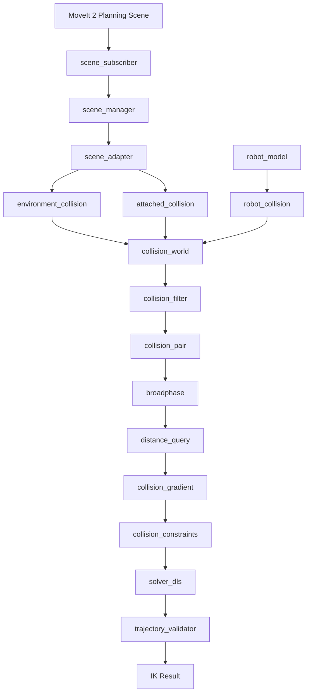

是的，上一版的 `collision` 目录过于精简了。它只覆盖了最基本的场景接入和距离查询，没有完整覆盖碰撞检测、距离梯度、碰撞策略、动态障碍物、附着物体和安全验证。

但也没必要拆成十几个零散文件。我建议采用一个相对完整、职责清晰的结构，全部使用 Python，不引入 C++。

### 一、推荐的完整文件架构

保留现有 IK 核心，只扩展场景管理和碰撞模块。

```text
pinocchio_ik/
│
├── solver.py
├── solver_dls.py
├── robot_model.py
│
├── scene/
│   ├── scene_subscriber.py       # 订阅 MoveIt PlanningScene
│   ├── scene_manager.py          # 场景状态管理
│   ├── scene_adapter.py          # MoveIt 消息解析与转换
│   └── scene_config.py           # 场景及坐标系配置
│
├── collision/
│   ├── collision_world.py       # 碰撞世界统一管理
│   ├── robot_collision.py       # 机器人碰撞几何体管理
│   ├── environment_collision.py # 环境障碍物管理
│   ├── attached_collision.py    # 附着物体管理
│   │
│   ├── geometry_factory.py      # 创建 Box / Sphere / Mesh 等
│   ├── geometry_cache.py        # 几何体缓存
│   │
│   ├── collision_filter.py      # SRDF / ACM / 允许碰撞过滤
│   ├── collision_pair.py        # 碰撞对管理
│   │
│   ├── broadphase.py            # AABB 粗筛
│   ├── distance_query.py        # 精确距离查询
│   ├── collision_gradient.py    # 距离梯度计算
│   │
│   ├── collision_constraints.py # 避障约束与安全距离
│   ├── collision_policy.py      # 碰撞策略与任务状态
│   └── trajectory_validator.py # 候选构型及轨迹安全验证
│
├── config/
│   ├── collision.yaml
│   └── scene.yaml
│
└── tests/
    ├── test_scene_sync.py
    ├── test_geometry.py
    ├── test_collision_pairs.py
    ├── test_distance.py
    ├── test_gradient.py
    ├── test_attached_object.py
    └── test_performance.py
```

### 二、Collision 目录各模块的具体职责

我把它分成五个层次。

### 1\. 碰撞几何体管理层

负责管理碰撞对象

| 文件                       | 主要职责                   |
| ------------------------ | ---------------------- |
| collision_world.py       | 管理整个碰撞世界，统一协调其他模块      |
| robot_collision.py       | 管理机器人全部碰撞 Mesh、位姿和几何索引 |
| environment_collision.py | 管理 MoveIt 中的桌面、墙壁、障碍物等 |
| attached_collision.py    | 管理抓取后附着在机器人 Link 上的物体  |
| geometry_factory.py      | 将 ROS 几何描述转换成 Coal 几何体 |
| geometry_cache.py        | 缓存已加载几何体，避免重复构建        |

这里最重要的是区分三种对象：

* Robot Geometry：机器人自身的碰撞几何体。

* Environment Geometry：环境障碍物。

* Attached Geometry：附着在机器人身上的物体。

三者都参与碰撞计算，但位姿更新方式不同。

### 2\. 碰撞关系管理层

负责决定检查哪些 Pair

| 文件                  | 主要职责                    |
| ------------------- | ----------------------- |
| collision_filter.py | 根据 SRDF、ACM 和任务规则过滤碰撞关系 |
| collision_pair.py   | 管理机器人自碰撞对、机器人与环境碰撞对     |

这里要特别注意：

你的 639 对自碰撞关系属于机器人自身的碰撞关系，应该独立保留。

环境障碍物加入后，还需要增加：

P_{\\text{environment}}
=
P_{\\text{robot}\\leftrightarrow\\text{environment}}

而不是重新生成全部机器人自碰撞对。

`collision_pair.py` 还应该负责 Pair 的启用、停用、增删和索引管理。

### 3\. 碰撞检测计算层

核心计算模块

| 文件                    | 主要职责                 |
| --------------------- | -------------------- |
| broadphase.py         | AABB 粗筛，排除可以证明安全的碰撞对 |
| distance_query.py     | 对候选 Pair 计算精确距离      |
| collision_gradient.py | 根据最近点和机器人雅可比计算距离梯度   |

计算流程：

\\text{All Geometry}
\\rightarrow
\\text{Broad Phase}
\\rightarrow
\\text{Candidate Pairs}
\\rightarrow
\\text{Narrow Phase}
\\rightarrow
d_i,\\ J_{d_i}

其中：

* Broad Phase 不负责最终碰撞判定。

* Distance Query 不负责管理场景。

* Collision Gradient 不负责修改 IK 结果。

这三个模块应该保持独立，方便单独测试和性能优化。

### 4\. 避障决策层

负责向 IK 提供避障信息

| 文件                       | 主要职责                  |
| ------------------------ | --------------------- |
| collision_constraints.py | 计算安全距离、距离约束、碰撞代价      |
| collision_policy.py      | 处理抓取阶段、允许接触、动态障碍物安全策略 |
| trajectory_validator.py  | 检查 DLS 候选结果和轨迹是否安全    |

这里需要区分：

Collision Gradient 是运动学计算，Collision Policy 是任务规则。

例如抓取过程中：

* Approach：所有手指都需要避障。

* Grasp：允许指定手指与目标物体接触。

* Transport：附着物体也参与环境避障。

* Release：恢复普通环境障碍物管理。

不能因为手指允许接触目标物体，就把整个手部的碰撞检测关闭。

### 5\. 场景接入层

这一层放在 `scene/`，而不是混进碰撞计算模块。

| 文件                  | 主要职责                                           |
| ------------------- | ---------------------------------------------- |
| scene_subscriber.py | 接收 MoveIt 2 的 PlanningScene 消息                 |
| scene_manager.py    | 管理场景版本、缓存和更新                                   |
| scene_adapter.py    | 解析 CollisionObject、AttachedCollisionObject、ACM |
| scene_config.py     | 管理 Planning Frame、TF 和同步参数                     |

这样碰撞算法不需要知道 ROS 消息的具体格式。

### 三、各模块之间的完整调用关系



### 四、哪些模块应该在每个 IK 周期执行？

这一点直接关系到你的实时性能。

| 模块                    | 执行时机              |
| --------------------- | ----------------- |
| scene_subscriber      | 收到 ROS 消息时        |
| scene_manager         | 场景更新时             |
| scene_adapter         | 场景消息变化时           |
| geometry_factory      | 新增或修改几何形状时        |
| geometry_cache        | 几何体创建或查找时         |
| robot_collision       | 每轮更新机器人构型时        |
| environment_collision | 环境位姿变化时           |
| attached_collision    | 机器人构型或附着状态变化时     |
| collision_filter      | 场景、ACM 或任务策略变化时   |
| collision_pair        | Pair 集合变化时        |
| broadphase            | 每轮碰撞检测时           |
| distance_query        | 候选 Pair 更新后或每轮迭代时 |
| collision_gradient    | 避障梯度需要更新时         |
| collision_constraints | 每轮 IK 避障计算时       |
| collision_policy      | 策略变化或约束计算时        |
| trajectory_validator  | 候选解或轨迹生成后         |

这里有一个重要优化：场景变化不等于几何结构变化，机器人运动也不等于环境几何体需要重建。

例如桌子没有移动，就不应该反复处理桌子的 Mesh；机器人手臂运动，也不应该重新加载 52 个机器人 Mesh。

### 五、我的最终建议：完整架构，但分阶段实现

上面是建议的最终模块边界，不代表现在就要全部写完。

| 开发阶段 | 实现文件                                                                                     | 目标                     |
| ---- | ---------------------------------------------------------------------------------------- | ---------------------- |
| 第一阶段 | scene_subscriber、scene_manager、scene_adapter、collision_world、geometry_factory            | MoveIt 障碍物进入 Pinocchio |
| 第二阶段 | robot_collision、environment_collision、attached_collision、collision_pair、collision_filter | 完整碰撞对象和 Pair 管理        |
| 第三阶段 | geometry_cache、broadphase、distance_query                                                 | 性能优化                   |
| 第四阶段 | collision_gradient、collision_constraints、collision_policy、trajectory_validator           | 接入 DLS 避障              |

我的判断：这版结构比较适合你的项目。 它覆盖了完整的场景管理、碰撞几何、碰撞对、粗精检测、距离梯度和安全验证，同时没有引入 C++，也没有把现有 DLS 求解器推倒重写。

另外，`collision_world.py` 应该作为唯一的碰撞系统总入口，其他模块由它组织；`solver_dls.py` 只调用它提供的接口，不直接操作底层 GeometryModel 和 CollisionPair。
